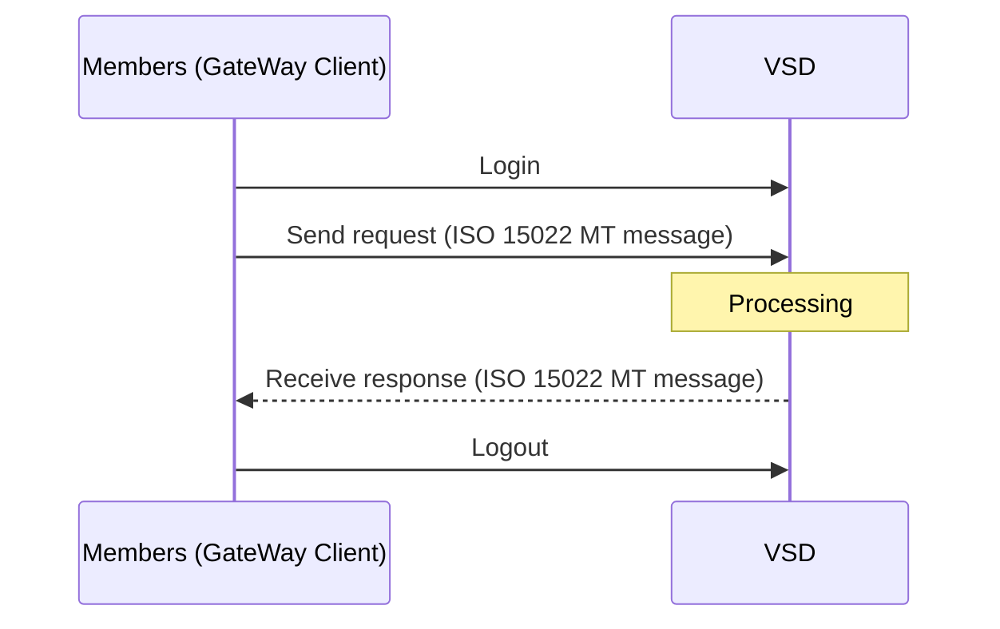

# Phương thức trao đổi điện nghiệp vụ (Phần I)

> Nguồn: Phụ lục 06 (QĐ 115/QĐ-VSD ngày 31/05/2017) — Phần I "PHƯƠNG THỨC TRAO ĐỔI ĐIỆN NGHIỆP VỤ". Chuyển thể nguyên văn, chỉ định dạng lại.

Tên đầy đủ của phụ lục: **Phụ lục 06 — Phương thức trao đổi và chuẩn điện nghiệp vụ qua Cổng giao tiếp trực tuyến của VSD cho hoạt động bù trừ, thanh toán giao dịch chứng khoán phái sinh** (ban hành kèm Quyết định số 115/QĐ-VSD ngày 31 tháng 5 năm 2017 của Tổng Giám đốc Trung tâm Lưu ký Chứng khoán Việt Nam).

## 1. Nguyên tắc chung

Hệ thống của Thành viên bù trừ (TVBT) trao đổi điện nghiệp vụ với hệ thống **GateWay của VSD** theo phương thức sau:

- Hệ thống của TVBT gửi và nhận điện nghiệp vụ qua **GateWay Client** theo phương thức **tự động quét** để nhận về và gửi file lên hệ thống thư mục được thiết lập trên GateWay Client.
- Các file phải tuân theo **cấu trúc điện FIN** (xem [02-cau-truc-dien-fin.md](02-cau-truc-dien-fin.md)) và **nguyên tắc chuyển đổi tiếng Việt** (xem [03-ky-tu-va-chuyen-doi-tieng-viet.md](03-ky-tu-va-chuyen-doi-tieng-viet.md)). *(Văn bản gốc viện dẫn là "Mục 3.1" và "Mục 3.2", nhưng trong tài liệu hai nội dung này đánh số là mục 1 và 2.)*

## 2. Cấu trúc thư mục GateWay Client

- Đường dẫn thư mục chính: `C:\Program Files\VSD_GatewayClient\`.
- Chương trình trỏ đến thư mục liên quan nghiệp vụ **chứng khoán cơ sở** và **phái sinh**; có thể chủ động cấu hình phần này trong file `\ext\com.fss.esb.client.properties` của phần mềm Gateway Client.
- Ứng với từng thư mục nghiệp vụ (cơ sở / phái sinh) có 4 thư mục con:

| Thư mục | Vai trò |
|---|---|
| `send` | Trạm trung chuyển điện gửi từ hệ thống BackOffice của TVBT lên hệ thống GateWay của VSD. Khi nhân viên nghiệp vụ thực hiện một giao dịch, BackOffice của TVBT phải tạo một điện tương ứng theo quy chuẩn VSD và chuyển vào thư mục `send`. Theo chu kỳ nhất định, GateWay Client tự động quét thư mục này và gửi điện lên GateWay của VSD. |
| `receive` | Chứa các điện nghiệp vụ nhận được từ GateWay của VSD gửi về TVBT. BackOffice của TVBT phải **tự động quét liên tục** thư mục này để nhận điện mới khi phát sinh. |
| `archive` | Chứa các tệp tin FIN và FileAct, tự động chuyển vào đây. Các điện **gửi đi thành công** tự động chuyển sang `archive`. |
| `error` | GateWay Client tự động chuyển điện sang `error` trong trường hợp việc gửi điện từ GateWay Client lên GateWay của VSD bị lỗi. |

> Văn bản gốc (mô tả thư mục `send`) có chỗ ghi "lên hệ thống GateWay của Thành viên bù trừ" — theo ngữ cảnh là GateWay của VSD.

## 3. Thiết lập kết nối

TVBT thiết lập kết nối từ GateWay Client tới GateWay của VSD để gửi và nhận điện nghiệp vụ:

1. Thiết lập kết nối **theo phiên làm việc**, đăng nhập bằng **username/password** và **khóa (Token key)** sử dụng **chữ ký số đại diện cho Doanh nghiệp do BKAV cung cấp**.
2. GateWay Client và GateWay của VSD thống nhất một **session key chung** để mã hóa thông tin trong suốt phiên làm việc.
3. Sau khi phiên làm việc được thiết lập, GateWay Client và GateWay của VSD trao đổi điện nghiệp vụ **tự động và liên tục**.

Sơ đồ trong tài liệu gốc mô tả kết cấu phiên làm việc giữa GateWay Client với GateWay của VSD (dựng lại từ chữ trong sơ đồ):

## 4. Liên quan

- Bảng mã lỗi trả về: [04-bang-ma-loi.md](04-bang-ma-loi.md) (một số mã lỗi liên quan chữ ký số / chứng thư số).
- Danh mục điện: [06-danh-muc-dien-mt.md](06-danh-muc-dien-mt.md).
