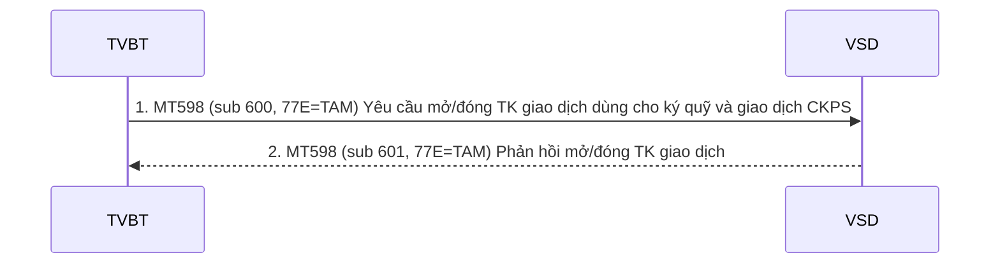
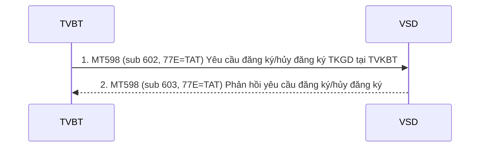

# Nhóm 1 — Đăng ký thông tin tài khoản giao dịch CKPS

> Nguồn: Phụ lục 06 (QĐ 115/QĐ-VSD ngày 31/05/2017) — Phần II, mục 1 (1.1–1.2). Nội dung chuyển thể nguyên văn từ file Word `Phu-luc-06.docx`; tra cứu thuật ngữ tại [00-tong-quan-va-thuat-ngu.md](../00-tong-quan-va-thuat-ngu.md).

## 1.1 Mở/đóng tài khoản giao dịch cho mục đích giao dịch và ký quỹ CKPS

Trình tự thực hiện:
- Bước 1: TVBT gửi điện MT598. Yêu cầu mở/đóng tài khoản giao dịch cho ký quỹ và giao dịch CKPS.
- Bước 2: Cán bộ VSD nhận điện, xử lý nghiệp vụ và phản hồi bằng điện MT598. Xác nhận yêu cầu mở/đóng tài khoản giao dịch cho ký quỹ và giao dịch CKPS.

#### MT598 -Yêu cầu mở/đóng tài khoản giao dịch cho ký quỹ và giao dịch CKPS

| Status | Tag | Qualifier | Field Name | Description | Content | No. |
|---|---|---|---|---|---|---|
| `M` | `20` |  | Transaction Reference Number | Số hiệu giao dịch: Đây là số hiệu tham chiếu của bên gửi (TVBT). Hệ thống VSD.STP kiểm soát tính loại điện và số hiệu tham chiếu phải là duy nhất. | `16x` | 1 |
| `M` | `12` |  | Sub-Message Type | Lấy giá trị 600 | `3!n` | 2 |
| `M` | `77E` |  | Proprietary Message | Lấy giá trị TAM | `73x` | 3 |
| **Bắt đầu khối: Thông tin chung** | | | | | | |
| `M` | `16R` | `GENL` |  |  |  | 4 |
| `M` | `23G` |  | Function of the Message | Lấy giá trị là: NEWM | `4!c` | 5 |
| `M` | `22H` | `ACCT` | Account Process Instruction | Chức năng: Mở tài khoản: ACCT//AOPN Đóng tài khoản: ACCT//ACLS | `4!c//4!c` | 6 |
| `O` | `98A` | `PREP` | Preparation Date | Ngày tạo yêu cầu (YYYYMMDD) | `:4!c//8!n` | 7 |
| `M` | `16S` | `GENL` |  |  |  | 8 |
| **Kết thúc khối: Thông tin chung** | | | | | | |
| **Bắt đầu khối: Thông tin chi tiết** | | | | | | |
| `M` | `16R` | `REGDET` |  |  |  | 9 |
| `M` | `97A` | `SAFE` |  | Số tài khoản giao dịch của NĐT | `:4!c//35x` | 10 |
| `M` | `95Q` | `INVE` |  | Tên đầy đủ của NĐT | `:4!c//4*35x` | 11 |
| `M` | `95S` | `ALTE` | Alternate ID | Thông tin đăng ký sở hữu, loại đăng ký sở hữu  4!c đầu là qualifier  [8c] lấy giá trị VISD cho VSD 4!c sau là Loại đăng ký sở hữu IDNO: Chứng minh thư VSDT: Hộ chiếu CORP: Giấy phép kinh doanh OTHR: Chứng thư khác FIIN: Mã Trading Code cho tổ chức nước ngoài ARNU: Mã Trading Code cho cá nhân nước ngoài GOVT: Cơ quan chính phủ  2!a là Mã quốc gia theo chuẩn ISO 3166 (http://www.iso.org/iso/country\_codes.htm)  Dựa vào thông tin loại đăng ký sở hữu và quốc tịch sẽ suy ra Loại hình cổ đông. VD:  3-Cá nhân trong nước             95S::ALTE/VISD/IDNO/VN/123456789 (Cá nhận trong nước dùng chứng minh thư) 3-Cá nhân trong nước             95S::ALTE/VISD/ VSDT /VN/123456789 (Cá nhận trong nước dùng hộ chiếu) 4-Cá nhân nước ngoài             95S::ALTE/VISD/VSDT/JP/123456789 (Cá nhận nước ngoài dùng hộ chiếu) 4-Cá nhân nước ngoài             95S::ALTE/VISD/ARNU/JP/123456789 (Cá nhận nước ngoài dùng trading code) 5-Pháp nhân trong nước         95S::ALTE/VISD/CORP/VN/123456789 6- Pháp nhân nước ngoài        95S::ALTE/VISD/FIIN/JP/123456789 7 – Nhà nước 95S::ALTE/VISD/GOVT/VN/123456789 | `4!c/8c/4!c/2!a/30x` | 12 |
| `M` | `98A` | `ISSU` |  | Ngày cấp CMT/hộ chiếu/giấy phép (YYYYMMDD) | `:4!c//8!n` | 13 |
| `O` | `94G` | `ISSU` |  | Nơi cấp CMT/hộ chiếu/giấy phép | `:4!c//2*35x` | 14 |
| `O` | `94G` | `EMAI` |  | Địa chỉ email Ký tự @ thay bằng (at) | `:4!c//2*35x` | 15 |
| `O` | `94G` | `PHON` |  | Số điện thoại | `:4!c//2*35x` | 16 |
| `M` | `94G` | `ADDR` |  | Địa chỉ | `:4!c//5*35x` | 17 |
| `M` | `70E` | `ADTX` |  | Account numbers: Số tài khoản giao dịch – bắt buộc phải có. Ví dụ: • :ADTX//TA//001C123456  Netted/Not-Netted Nếu là mở tài khoản bắt buộc lấy giá trị: NETT//OMNI là tài khoản Omnibus (Not – netted) NETT//NETT là netted  Type Loại hình tài khoản lấy một trong các giá trị sau: • Cá nhân trong nước = TYPE//DOMIND • Cá nhân nước ngoài = TYPE//FORIND • Tổ chức trong nước = TYPE//DOMCORP • Tổ chức nước ngoài = TYPE//FORCORP | `:4!c//10*35x` | 18 |
| `M` | `16S` | `REGDET` |  |  |  | 19 |
| **End of Block: Detail request information** | | | | | | |

#### MT598 - Xác nhận kết quả mở/đóng tài khoản giao dịch cho ký quỹ và giao dịch CKPS

| Status | Tag | Qualifier | Field Name | Description | Content | No. |
|---|---|---|---|---|---|---|
| `M` | `20` |  | Transaction Reference Number | Số hiệu giao dịch: Đây là số hiệu tham chiếu của VSD trả lời | `16x` | 1 |
| `M` | `12` |  | Sub-Message Type | Lấy giá trị 601 | `3!n` | 2 |
| `M` | `77E` |  | Proprietary Message | Giá trị là TAM | `73x` | 3 |
| **Bắt đầu khối: Thông tin chung** | | | | | | |
| `M` | `16R` | `GENL` |  |  |  | 4 |
| `M` | `23G` |  | Function of the Message | Giá trị là NEWM | `4!c` | 5 |
| `M` | `22H` | `ACCT` | Account Process Instruction | Chức năng: Mở tài khoản: ACCT//AOPN Đóng tài khoản: ACCT//ACLS | `4!c//4!c` | 6 |
| `O` | `98A` | `PREP` | Preparation Date | Ngày tạo message (YYYYMMDD) | `:4!c//8!n` | 7 |
| `M` | `16R` | `LINK` |  |  |  | 8 |
| `M` | `20C` | `RELA` |  | Tham chiếu đến số hiệu yêu cầu ở trường 20 ở điện yêu cầu liên quan | `:4!c//16x` | 9 |
| `M` | `16S` | `LINK` |  |  |  | 10 |
| `M` | `16S` | `GENL` |  |  |  | 11 |
| **Kết thúc khối: Thông tin chung** | | | | | | |
| **Bắt đầu khối: Trạng thái** | | | | | | |
| `M` | `16R` | `STAT` |  |  |  | 12 |
| `M` | `25D` | `IPRC` |  | Giá trị phản hồi PACK: Đồng ý REJT : Từ chối | `:4!c//4a` | 13 |
| `O` | `70D` | `REAS` |  | Nguyên nhân từ chối nếu giá trị của trường 25D=IPRC//REJT | `:4!c//6*35x` | 14 |
| `O` | `70E` | `ADTX` |  | Account numbers: Số tài khoản giao dịch – bắt buộc phải có. Ví dụ: • :ADTX//TA//001C123456 Số tài khoản ký quỹ tại VSD. Ví dụ: • MA//001C123456 Số định danh tại CCP. Ví dụ: • CA/VSD00000001 Netted/Not-Netted Nếu là mở tài khoản bắt buộc lấy giá trị: NETT//OMNI là tài khoản Omnibus (Not – netted) NETT//NETT là netted Type Loại hình tài khoản lấy một trong các giá trị sau: • Cá nhân trong nước = TYPE//DOMIND • Cá nhân nước ngoài = TYPE//FORIND • Tổ chức trong nước = TYPE//DOMCORP • Tổ chức nước ngoài = TYPE//FORCORP | `:4!c//6*35x` | 15 |
| `M` | `16S` | `STAT` |  |  |  | 16 |
| **Kết thúc khối: Trạng thái** | | | | | | |

## 1.2 Đăng ký/hủy đăng ký tài khoản giao dịch CKPS

(\*) trường hợp nhà đầu tư sử dụng Tài khoản giao dich (TKGD) mở tại Thành viên không bù trừ (TVKBT) và thực hiện bù trừ trên tại khoản ký quỹ mở tại TVBT

Thứ tự thực hiện:
- TVBT gửi điện MT598. Yêu cầu đăng ký/hủy đăng ký tài khoản giao dịch tại TVKBT dùng cho giao dịch CKPS
- VSD nhận và phản hồi bằng điện MT598. Phản hồi yêu cầu đăng ký/hủy đăng ký tài khoản giao dịch tại TVKBT dùng cho giao dịch CKPS

#### MT598 -Yêu cầu đăng ký/hủy đăng ký tài khoản giao dịch tại TVKBT dùng cho giao dịch CKPS

| Status | Tag | Qualifier | Field Name | Description | Content | No. |
|---|---|---|---|---|---|---|
| `M` | `20` |  | Transaction Reference Number | Số hiệu giao dịch: Đây là số hiệu tham chiếu của bên gửi (TVBT). Hệ thống VSD.STP kiểm soát tính loại điện và số hiệu tham chiếu phải là duy nhất. | `16x` | 1 |
| `M` | `12` |  | Sub-MessageType | Lấy giá trị 602 | `3!n` | 2 |
| `M` | `77E` |  | Proprietary Message | Lấy giá trị TAT | `73x` | 3 |
| **Bắt đầu khối: Thông tin chung** | | | | | | |
| `M` | `16R` | `GENL` |  |  |  | 4 |
| `M` | `23G` |  | Function of the Message | Lấy giá trị là: NEWM | `4!c` | 5 |
| `M` | `22H` | `ACCT` | Account Process Instruction | Chức năng: Đăng ký: ACCT//AOPN Hủy đăng ký: ACCT//ACLS | `4!c//4!c` | 6 |
| `O` | `98A` | `PREP` | Preparation Date | Ngày tạo yêu cầu (YYYYMMDD) | `:4!c//8!n` | 7 |
| `M` | `16S` | `GENL` |  |  |  | 8 |
| **Kết thúc khối: Thông tin chung** | | | | | | |
| **Bắt đầu khối: Thông tin chi tiết** | | | | | | |
| `M` | `16R` | `REGDET` |  |  |  | 9 |
| `M` | `97A` | `SAFE` |  | Số tài khoản ký quỹ CKPS của NĐT | `:4!c//35x` | 10 |
| `M` | `95Q` | `INVE` |  | Tên đầy đủ của NĐT | `:4!c//4*35x` | 11 |
| `M` | `95S` | `ALTE` | Alternate ID | Thông tin đăng ký sở hữu, loại đăng ký sở hữu  4!c đầu là qualifier  [8c] lấy giá trị VISD cho VSD  4!c sau là Loại đăng ký sở hữu IDNO: Chứng minh thư VSDT: Hộ chiếu CORP: Giấy phép kinh doanh OTHR: Chứng thư khác FIIN: Mã Trading Code cho tổ chức nước ngoài ARNU: Mã Trading Code cho cá nhân nước ngoài GOVT: Cơ quan chính phủ  2!a là Mã quốc gia theo chuẩn ISO 3166 (http://www.iso.org/iso/country\_codes.htm)  Dựa vào thông tin loại đăng ký sở hữu và quốc tịch sẽ suy ra Loại hình cổ đông. VD:  3-Cá nhân trong nước             95S::ALTE/VISD/IDNO/VN/123456789 (Cá nhận trong nước dùng chứng minh thư) 3-Cá nhân trong nước             95S::ALTE/VISD/ VSDT /VN/123456789 (Cá nhận trong nước dùng hộ chiếu) 4-Cá nhân nước ngoài             95S::ALTE/VISD/VSDT/JP/123456789 (Cá nhận nước ngoài dùng hộ chiếu) 4-Cá nhân nước ngoài             95S::ALTE/VISD/ARNU/JP/123456789 (Cá nhận nước ngoài dùng trading code) 5-Pháp nhân trong nước         95S::ALTE/VISD/CORP/VN/123456789 6- Pháp nhân nước ngoài        95S::ALTE/VISD/FIIN/JP/123456789 7- Nhà nước                            95S::ALTE/VISD/GOVT/VN/123456789 | `4!c/8c/4!c/2!a/30x` | 12 |
| `M` | `98A` | `ISSU` |  | Ngày cấp CMT/hộ chiếu/giấy phép (YYYYMMDD) | `:4!c//8!n` | 13 |
| `O` | `94G` | `ISSU` |  | Nơi cấp CMT/hộ chiếu/giấy phép | `:4!c//2*35x` | 14 |
| `O` | `94G` | `EMAI` |  | Địa chỉ email Ký tự @ thay bằng (at) | `:4!c//2*35x` | 15 |
| `O` | `94G` | `PHON` |  | Số điện thoại | `:4!c//2*35x` | 16 |
| `M` | `94G` | `ADDR` |  | Địa chỉ | `:4!c//5*35x` | 17 |
| `M` | `70E` | `ADTX` |  | Account numbers: Số tài khoản giao dịch tại NCM được đăng ký/hủy đăng ký – bắt buộc phải có. Ví dụ: • :ADTX//TA//001C123456  Netted/Not-Netted Nếu là mở tài khoản bắt buộc lấy giá trị: NETT//OMNI là tài khoản Omnibus (Not – netted) NETT//NETT là netted  Type Loại hình tài khoản lấy một trong các giá trị sau: • Cá nhân trong nước = TYPE//DOMIND • Cá nhân nước ngoài = TYPE//FORIND • Tổ chức trong nước = TYPE//DOMCORP • Tổ chức nước ngoài = TYPE//FORCORP | `:4!c//10*35x` | 18 |
| `M` | `16S` | `REGDET` |  |  |  | 19 |
| **End of Block: Detail request information** | | | | | | |

#### MT598 - Xác nhận kết quả đăng ký/hủy đăng ký tài khoản giao dịch tại TVKBT dùng cho giao dịch CKPS

| Status | Tag | Qualifier | Field Name | Description | Content | No. |
|---|---|---|---|---|---|---|
| `M` | `20` |  | Transaction Reference Number | Số hiệu giao dịch: Đây là số hiệu tham chiếu của VSD trả lời | `16x` | 1 |
| `M` | `12` |  | Sub-Message Type | Lấy giá trị 603 | `3!n` | 2 |
| `M` | `77E` |  | Proprietary Message | Giá trị là TAT | `73x` | 3 |
| **Bắt đầu khối: Thông tin chung** | | | | | | |
| `M` | `16R` | `GENL` |  |  |  | 4 |
| `M` | `23G` |  | Function of the Message | Giá trị là NEWM | `4!c` | 5 |
| `M` | `22H` | `ACCT` | Account Process Instruction | Chức năng: Đăng ký: ACCT//AOPN Hủy đăng ký: ACCT//ACLS | `4!c//4!c` | 6 |
| `O` | `98A` | `PREP` | Preparation Date | Ngày tạo message (YYYYMMDD) | `:4!c//8!n` | 7 |
| `M` | `16R` | `LINK` |  |  |  | 8 |
| `M` | `20C` | `RELA` |  | Tham chiếu đến số hiệu yêu cầu ở trường 20 ở điện yêu cầu liên quan | `:4!c//16x` | 9 |
| `M` | `16S` | `LINK` |  |  |  | 10 |
| `M` | `16S` | `GENL` |  |  |  | 11 |
| **Kết thúc khối: Thông tin chung** | | | | | | |
| **Bắt đầu khối: Trạng thái** | | | | | | |
| `M` | `16R` | `STAT` |  |  |  | 12 |
| `M` | `25D` | `IPRC` |  | Giá trị phản hồi PACK: Đồng ý REJT : Từ chối | `:4!c//4a` | 13 |
| `O` | `70D` | `REAS` |  | Nguyên nhân từ chối nếu giá trị của trường 25D=IPRC//REJT | `:4!c//6*35x` | 14 |
| `O` | `70E` | `ADTX` |  | Account numbers: Số tài khoản giao dịch – bắt buộc phải có. Ví dụ: • :ADTX//TA//001C123456 Số tài khoản ký quỹ tại VSD. Ví dụ: • MA//001C123456 Số định danh tại CCP. Ví dụ: • CA/VSD00000001  Netted/Not-Netted Nếu là mở tài khoản bắt buộc lấy giá trị: NETT//OMNI là tài khoản Omnibus (Not – netted) NETT//NETT là netted  Type Loại hình tài khoản lấy một trong các giá trị sau: • Cá nhân trong nước = TYPE//DOMIND • Cá nhân nước ngoài = TYPE//FORIND • Tổ chức trong nước = TYPE//DOMCORP • Tổ chức nước ngoài = TYPE//FORCORP | `:4!c//6*35x` | 15 |
| `M` | `16S` | `STAT` |  |  |  | 16 |
| **Kết thúc khối: Trạng thái** | | | | | | |

