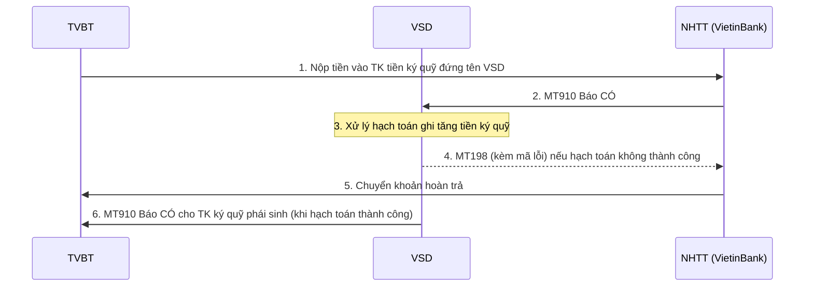
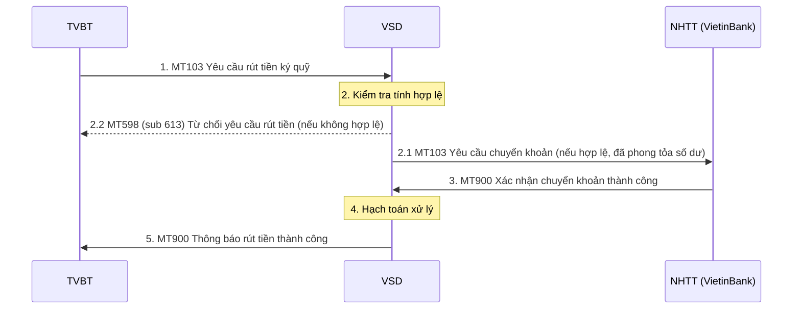
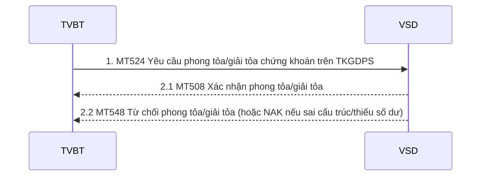
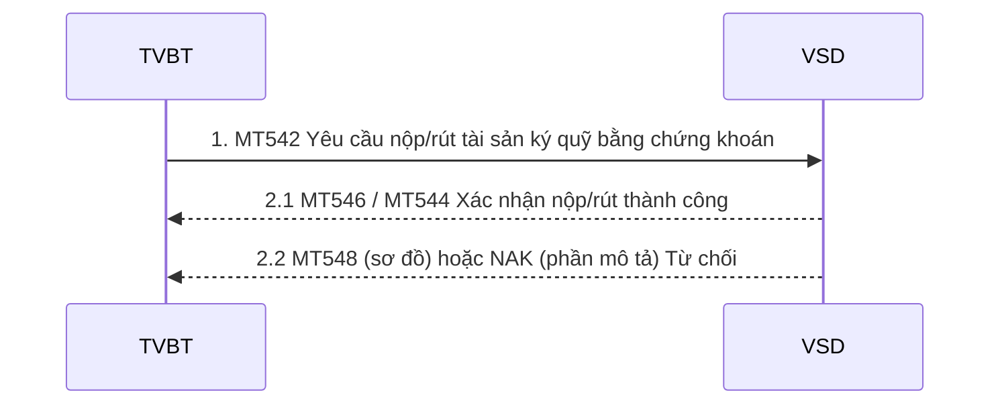

# Nhóm 2 — Nộp/rút ký quỹ

> Nguồn: Phụ lục 06 (QĐ 115/QĐ-VSD ngày 31/05/2017) — Phần II, mục 2 (2.1–2.5). Nội dung chuyển thể nguyên văn từ file Word `Phu-luc-06.docx`; tra cứu thuật ngữ tại [00-tong-quan-va-thuat-ngu.md](../00-tong-quan-va-thuat-ngu.md).

## 2.1. TVBT nộp ký quỹ bằng tiền

Trình tự thực hiện:
- Bước 1: TVBT nộp tiền vào tài khoản tiền ký quỹ đứng tên VSD tại Ngân hàng thanh toán (NHTT) - VIETINBANK;
- Bước 2: NHTT gửi báo CÓ cho VSD (điện MT910. Báo CÓ từ ngân hàng)
- Bước 3: VSD xử lý hạch toán ghi tăng tiền ký quỹ. Đối với trường hợp hạch toán không thành công thực hiện riêng quy trình theo bước 4 & bước 5:
- Bước 4: Trường hợp hạch toán không thành công (do số tài khoản không tồn tại trên hệ thống VSD), VSD gửi điện phản hồi MT198 cho VIETINBANK (kèm mã lỗi).
- Bước 5: VIETINBANK thực hiện chuyển khoản hoàn trả cho TVBT lại số tiền đã nộp.
- Bước 6: Sau khi hạch toán thành công VSD gửi điện thông báo ghi tăng tiền ký quỹ cho từng tài khoản ký quỹ của TVBT/NĐT (điện MT910. Báo CÓ cho tài khoản ký quỹ phái sinh) và kết thúc.

Lưu ý: Trường hợp TVBT phát hiện chuyển nhầm ký quỹ (ví dụ: NĐT A  NĐT B)  TVBT phải thực hiện giao dịch rút/nộp ký quỹ để điều chỉnh lại.

#### MT910 –Báo CÓ từ VSD (VSD thông báo cho TVBT về ghi tăng tài khoản NĐT)

| Status | Tag | Qualifier | Field Name | Description | Content | No. |
|---|---|---|---|---|---|---|
| `M` | `20` |  | Transaction Reference Number | Số hiệu tham chiếu của VSD | `16x` | 1 |
| `M` | `21` |  | Related Reference | Số hiệu tham chiếu báo CÓ của ngân hàng | `16x` | 2 |
| `M` | `25` |  | Account Identification | Số tài khoản tại ngân hàng được ghi tăng số dư Là tài khoản BICCODE.C hoặc BICCODE.P tùy theo nộp tiền cho khách hàng hay tự doanh | `35x` | 3 |
| `M` | `32A` |  | Value Date, Currency, Amount | Ngày giao dịch Loại tiền Số tiền | `6!n3!a17d` | 4 |
| `M` | `52A` |  |  | BICCODE của TVBT | `4!a2!a2!c[3!c]` | 5 |
| `M` | `72` |  | Sender to Receiver information | Nội dung diễn giải của ngân hàng IM//001C123456 (VSD qui định cho TVBT điền nội dung này khi nộp tiền ký quỹ cho NĐT/tự doanh) | `73x` | 6 |

## 2.2. TVBT yêu cầu rút tài sản ký quỹ bằng tiền

Trình tự thực hiện:
- Bước 1: TVBT gửi điện MT103 yêu cầu rút tài sản ký quỹ bằng tiền đến VSD
- Bước 2: Hệ thống VSD kiểm tra tính hợp lệ của yêu cầu rút:

2.1. Hợp lệ: Phong tỏa số dư rút trên hệ thống &Yêu cầu VIETINBANK thực hiện chuyển tiền bằng điện MT103 (chuyển sang bước 3).

2.2. Không hợp lệ: Thông báo TVBT từ chối yêu cầu rút tiền bằng điện MT598
- Bước 3: VIETINBANK xác nhận với VSD chuyển khoản thành công bằng điện MT900
- Bước 4: VSD xử lý hạch toán
- Bước 5: VSD gửi điện MT900 cho TVBT thông báo rút tiền thành công.

#### MT103 –Yêu cầu rút tiền ký quỹ

| Status | Tag | Qualifier | Field Name | Description | Content | No. |
|---|---|---|---|---|---|---|
| `M` | `20` |  | Transaction Reference Number | Số hiệu tham chiếu yêu cầu của TVBT | `16x` | 1 |
| `M` | `23B` | `CRED` | Bank Operation Code |  | `4!c` | 2 |
| `M` | `32A` |  |  | Ngày hiệu lực/Loại tiền/Số tiền | `6!n3!a15d` | 3 |
| `M` | `50K` |  | Ordering Customer | Thông tin bên chuyển Lấy giá trị BICCODE.P hoặc BICCODE.C tùy theo tài khoản được rút là của tự doanh hay khách hàng | `34x` | 4 |
| `M` | `59` |  | Beneficiary Customer | Lấy giá trị BICCODE.R | `34x` | 5 |
| `M` | `70` |  | Remittance information | IM//Số tài khoản ký quỹ phái sinh tự doanh/NĐT (ví dụ 001C123456) | `35x` | 6 |
| `M` | `71A` |  |  | Lấy giá trị BEN | `3!a` | 7 |

#### MT900 –Thông báo rút tiền thành công

| Status | Tag | Qualifier | Field Name | Description | Content | No. |
|---|---|---|---|---|---|---|
| `M` | `20` |  | Transaction Reference Number | Số hiệu tham chiếu của VSD | `16x` | 1 |
| `M` | `21` |  | Related Reference | Số hiệu tham chiếu đến yêu cầu rút tiền của TVBT (trường 20 của MT103) | `16x` | 2 |
| `M` | `25` |  | Account Identification | Số tài khoản của TVBT tại ngân hàng nhận tiền (Trường 50K của MT103) | `35x` | 3 |
| `M` | `32A` |  | Value Date, Currency, Amount | Ngày giao dịch Loại tiền Số tiền | `6!n3!a15d` | 4 |
| `M` | `52A` |  |  | BICCODE của TVBT | `4!a2!a2!c[3!c]` | 5 |
| `M` | `72` |  | Sender to Receiver information | Số tài khoản ký quỹ của NĐT thực hiện rút tiền (Trường 70 của MT103) | `6*35x` | 6 |

#### MT598 – Thông báo từ chối yêu cầu rút tiền

| Status | Tag | Qualifier | Field Name | Description | Content | No. |
|---|---|---|---|---|---|---|
| `M` | `20` |  | Transaction Reference Number | Số hiệu tham chiếu của VSD | `16x` | 1 |
| `M` | `12` |  | Sub-Message Type | Lấy giá trị 613 | `3!n` | 2 |
| `M` | `77E` |  | Proprietary Message | Lấy giá trị CASH | `73x` | 3 |
| **Bắt đầu khối: Thông tin chung** | | | | | | |
| `M` | `16R` | `GENL` |  |  |  | 4 |
| `M` | `23G` |  | Function of the Message | Lấy giá trị là: REJT | `4!c` | 5 |
| `M` | `98A` | `PREP` | Preparation Date | Ngày tạo (YYYYMMDD) | `:4!c//8!n` | 7 |
| `M` | `16R` | `LINK` |  |  |  | 8 |
| `M` | `20C` | `RELA` | Report reference | Tham chiếu đến điện MT103 yêu cầu rút tiền (trường 20) | `:4!c//16x` | 9 |
| `M` | `16S` | `LINK` |  |  |  | 10 |
| `M` | `70D` | `REAS` | Report reference | Lý do từ chối | `:4!c//35x` | 11 |
| `M` | `16S` | `GENL` |  |  |  | 12 |
| **Kết thúc khối: Thông tin chung** | | | | | | |

## 2.3. TVBT yêu cầu VSD phong tỏa/giải tỏa chứng khoán trên tài khoản ký quỹ giao dịch phái sinh NĐT

Trình tự thực hiện:
- Bước 1: TVBT thông báo cho VSD về việc phong tỏa/giải tỏa tài sản ký quỹ là chứng khoán bằng điện MT524.
- Bước 2:

2.1: Nếu thành công, VSD gửi điện MT508 xác nhận yêu cầu.

2.2: Nếu không thành công (cán bộ VSD từ chối duyệt), VSD gửi điện NAK/MT548 từ chối yêu cầu (NAK trong trường hợp sai cấu trúc điện, thiếu số dư…; MT548 trong trường hợp user VSD từ chối duyệt giao dịch)

#### MT524 - Yêu cầu phong tỏa/giải tỏa tài sản ký quỹ là chứng khoán

| Status | Tag | Qualifier | Field Name | Description | Content | No. |
|---|---|---|---|---|---|---|
| **Bắt đầu Block: Thông tin chung** | | | | | | |
| `M` | `16R` | `GENL` |  |  |  | 1 |
| `M` | `20C` | `SEME` | Reference | Tham chiếu số hiệu yêu cầu gửi từ TVBT | `:4!c//16x` | 2 |
| `M` | `23G` |  | Function of the Message | NEWM: Yêu cầu phong tỏa/giải tỏa chứng khoán CANC: Hủy yêu cầu phong tỏa/giải tỏa chứng khoán | `4!c` | 3 |
| `O` | `98A` | `PREP` | Preparation Date | Ngày tạo message | `:4!c//8!n` | 4 |
| `O` | `16R` | `LINK` |  |  |  | 5 |
| `M` | `20C` | `4!c` | 4!c | Nếu 23G = CANC Dùng để liên kết đến Yêu cầu phong tỏa/giải tỏa chứng khoán trước đó | `:4!c//16x` | 6 |
| `O` | `16S` | `LINK` |  |  |  | 7 |
| `M` | `16S` | `GENL` |  |  |  | 8 |
| **Kết thúc Block: Thông tin chung** | | | | | | |
| **Bắt đầu Block: Thông tin giao dịch** | | | | | | |
| `M` | `16R` | `INPOSDET` |  |  |  | 9 |
| `M` | `95P` | `ACOW` |  | Mã BICCODE của TVBT | `:4!c//4!a2!a2!c[3!c]` | 10 |
| `M` | `97A` | `SAFE` |  | Số tài khoản ký quỹ giao dịch | `:4!c//35x` | 11 |
| `M` | `36B` | `SETT` | Quantity of financial instrument | Khối lượng Giá trị của qualifier :SETT//UNIT, sử dụng cho cổ phiếu, chứng chỉ quỹ :SETT//FAMT, sử dụng cho trái phiếu | `:4!c//4!c/15d` | 12 |
| `M` | `35B` |  |  | Chứng khoán | [ISIN1!e12!c] [/2!a/32x] | 13 |
| `M` | `98A` | `SETT` |  | Ngày hạch toán | `:4!c//8!n` | 14 |
| `M` | `70E` | `SPRO` |  | Ghi chú | `:4!c//10*35x` | 15 |
| `M` | `93A` | `FROM` | Balance | Loại giao dịch :FROM//AVAL, nộp :FROM//COLA, rút | `:4!c//4!c` | 16 |
| `M` | `93A` | `TOBA` |  | :TOBA//COLA, nộp :TOBA//AVAL, rút | `:4!c//4!c` | 17 |
| `M` | `16S` | `INPOSDET` |  |  |  | 18 |
| **Kết thúc Block: Thông tin giao dịch** | | | | | | |

#### MT508 - Xác nhận kết quả phong tỏa/giải tỏa tài sản ký quỹ là chứng khoán của NĐT

| Status | Tag | Qualifier | Field Name | Description | Content | No. |
|---|---|---|---|---|---|---|
| **Bắt đầu Block: Thông tin chung** | | | | | | |
| `M` | `16R` | `GENL` |  |  |  | 1 |
| `M` | `20C` | `SEME` | Reference | Số hiệu tham chiếu của VSD | `:4!c//16x` | 2 |
| `M` | `23G` |  | Function of the Message | Lấy giá trị NEWM: Xác nhận CANC: Hủy xác nhận | `4!c` | 3 |
| `O` | `98A` | `PREP` | Preparation Date | Ngày tạo message | `:4!c//8!n` | 4 |
| `O` | `16R` | `LINK` |  |  |  | 5 |
| `M` | `13A` | `LINK` |  | Lấy giá trị là :LINK//524 nếu 23G=NEWM :LINK//508 nếu 23G=CANC | `:4!c//3!c` | 6 |
| `M` | `20C` | `4!c` |  | RELA: Tham chiếu đến Yêu cầu phong tỏa/giải tỏa chứng khoán (23G=NEWM) PREV: Tham chiếu đến Yêu cầu phong tỏa/giải tỏa chứng khoán (23G=CANC) | `:4!c//16x` | 7 |
| `O` | `16S` | `LINK` |  |  |  | 8 |
| `M` | `16S` | `GENL` |  |  |  | 9 |
| **Kết thúc Block: Thông tin chung** | | | | | | |
| **Bắt đầu Block: Thông tin giao dịch** | | | | | | |
| `M` | `16R` | `INPOSDET` |  |  |  | 10 |
| `M` | `95P` | `ACOW` | Party | BICCODE của TVBT | `:4!c//4!a2!a2!c[3!c]` | 11 |
| `M` | `97A` | `SAFE` | Account | Số tài khoản NĐT/TVBT | `:4!c//35x` | 12 |
| `M` | `36B` | `ESTT` | Quantity | Khối lượng Giá trị của qualifier :ESTT//UNIT, sử dụng cho cổ phiếu, chứng chỉ quỹ :ESTT//FAMT, sử dụng cho trái phiếu | `:4!c//4!c/15d` | 13 |
| `M` | `35B` |  |  | Chứng khoán | [ISIN1!e12!c] [2!a/32x] | 14 |
| `M` | `98A` | `SETT` | Date | Ngày hạch toán | `:4!c//8!n` | 15 |
| `O` | `70E` | `SPRO` |  | Ghi chú |  | 16 |
| `M` | `93A` |  | Balance | Loại giao dịch :FROM//AVAL, phong tỏa :FROM//COLA, giải tỏa | `:4!c//4!c` | 17 |
| `M` | `93A` |  | Balance | :TOBA//COLA, phong tỏa :TOBA//AVAL, giải tỏa | `:4!c//4!c` | 18 |
| `M` | `16S` | `INPOSDET` |  |  |  | 19 |
| **Kết thúc Block: Thông tin giao dịch** | | | | | | |

#### MT548 - Từ chối yêu cầu phong tỏa/giải tỏa chứng khoán

| Status | Tag | Qualifier | Field Name | Description | Content | No. |
|---|---|---|---|---|---|---|
| **Bắt đầu Block: Thông tin chung** | | | | | | |
| `M` | `16R` | `GENL` |  |  |  | 1 |
| `M` | `20C` | `SEME` | Reference | Số hiệu tham chiếu của VSD | `:4!c//16x` | 2 |
| `M` | `23G` | `INST` | Function of the Message |  | `4!c` | 3 |
| `O` | `98A` | `PREP` | Preparation Date | Ngày tạo message | `:4!c//8!n` | 4 |
| `M` | `16R` | `LINK` |  |  |  | 5 |
| `O` | `13a` | `LINK` | Number identification | Lấy giá trị :LINK//524. | `:4!c//3!c` | 6 |
| `M` | `20C` | `RELA` | Reference | Tham chiếu đến Yêu cầu phong tỏa/giải tỏa chứng khoán | `:4!c//16x` | 7 |
| `M` | `16S` | `LINK` |  |  |  | 8 |
| `M` | `16R` | `STAT` |  |  |  | 9 |
| `M` | `25D` | `IPRC` | Status | Lấy giá trị :IPRC//REJT | `:4!c//4!c` | 10 |
| `M` | `16R` | `REAS` |  |  |  | 11 |
| `M` | `24B` | `REJT` | Reason | Lấy giá trị :REJT/NARR | `:4!c//4!c` | 12 |
| `O` | `70D` | `REAS` |  | Nội dung từ chối | `:4!c//6*35x` | 13 |
| `M` | `16S` | `REAS` |  |  |  | 14 |
| `M` | `16S` | `STAT` |  |  |  | 15 |
| `M` | `16S` | `GENL` |  |  |  | 16 |
| **Bắt đầu Block: Thông tin chung** | | | | | | |

## 2.4.TVBT nộp ký quỹ/rút tài sản ký quỹ bằng chứng khoán cho VSD

Trình tự thực hiện:
- Bước 1: TVBT gửi điện MT542 yêu cầu nộp/rút tài sản ký quỹ bằng chứng khoán. Yêu cầu này sẽ thực hiện chuyển khoản chứng khoán giữa hệ thống lưu ký và hệ thống phái sinh.
- Bước 2: Hệ thống VSD kiểm tra và xử lý yêu cầu nộp/rút tài sản ký quỹ bằng chứng khoán:
- Trường hợp chuyển thành công sẽ gửi điện MT546 (thông báo ghi giảm số dư)/MT544 (thông báo ghi tăng số dư) phục vụ xác nhận nộp/rút tài sản ký quỹ bằng chứng khoán thành công cụ thể như sau:.
- Đối với trường hợp nộp: MT546 thông báo giảm số dư tại hệ thống lưu ký, MT544 thông báo tăng số dư tại hệ thống phái sinh
- Đối với trường hợp rút: MT546 thông báo giảm số dư tại hệ thống phái sinh, MT544 thông báo tăng số dư tại hệ thống lưu ký
- Trường hợp không thực hiện được (sai cấu trúc điện, thiếu số dư…) sẽ gửi điện NAK từ chối yêu cầu nộp/rút tài sản ký quỹ bằng chứng khoán.

#### MT542 –Yêu cầu nộp/rút tài sản ký quỹ bằng chứng khoán

| Status | Tag | Qualifier | Field Name | Description | Content | No. |
|---|---|---|---|---|---|---|
| **Bắt đầu Block: Thông tin chung** | | | | | | |
| `M` | `16R` | `GENL` |  |  |  | 1 |
| `M` | `20C` | `SEME` | Reference | Số hiệu tham chiếu của TVBT (giá trị này là duy nhất) | `:4!c//16x` | 2 |
| `M` | `23G` | `NEWM` | Function of the Message | NEWM: Yêu cầu chuyển khoản | `4!c` | 3 |
| `O` | `98A` | `PREP` | Preparation Date | Ngày tạo yêu cầu | `:4!c//8!n` | 4 |
| `M` | `16S` | `GENL` |  |  |  | 5 |
| **Kết thúc Block: Thông tin chung** | | | | | | |
| **Bắt đầu Block: Chuyển khoản chi tiết** | | | | | | |
| `M` | `16R` | `TRADDET` |  |  |  | 6 |
| `M` | `98A` | `SETT` | Date | Ngày giao dịch | `:4!c//8!n` | 7 |
| `M` | `35B` |  | Identification of the Financial Instrument | Chứng khoán | [ISIN1!e12!c] [/2!a/32x] | 8 |
| `O` | `16R` | `FIA` |  |  |  | 9 |
| `M` | `12A` | `4!c` | Type of Financial Instrument | Lấy giá trị :CLAS//NORM/1 | `:4!c//4!c/1!n` | 10 |
| `O` | `16S` | `FIA` |  |  |  | 11 |
| `O` | `70E` | `SPRO` | Narrative | Ghi chú | `:4!c//4*35x` | 12 |
| `M` | `16S` | `TRADDET` |  |  |  | 13 |
| **Kết thúc Block: Chuyển khoản chi tiết** | | | | | | |
| **Bắt đầu Block: Thông tin tài khoản chuyển** | | | | | | |
| `M` | `16R` | `FIAC` |  |  |  | 14 |
| `M` | `36B` | `SETT` | Quantity | Khối lượng  Giá trị của qualifier :SETT//UNIT, sử dụng cho cổ phiếu, chứng chỉ quỹ :SETT//FAMT, sử dụng cho trái phiếu | `:4!c//4!c/15d` | 15 |
| `O` | `70D` | `DENC` | Narrative | Ghi chú | `:4!c//6*35x` | 16 |
| `M` | `95P` | `ACOW` | Party | BICCODE của TVBT | `:4!c//4!a2!a2!c[3c]` | 17 |
| `M` | `97A` | `SAFE` | Account | Tài khoản giao dịchcho ký quỹ | `:4!c//35x` | 18 |
| `M` | `16S` | `FIAC` |  |  |  | 19 |
| **Kết thúc Block: Thông tin tài khoản chuyển** | | | | | | |
| **Bắt đầu Block: Thông tin thanh toán chi tiết** | | | | | | |
| `M` | `16R` | `SETDET` |  |  |  | 20 |
| `M` | `22F` | `SETR` | Indicator | Lấy giá trị :SETR//COLI: Nộp :SETR//COLO: Rút | `:4!c//4!c` | 21 |
| `M` | `22F` | `STCO` | Indicator | Lấy giá trị :STCO//DLWM | `:4!c//4!c` | 22 |
| `M` | `16R` | `SETPRTY` |  |  |  | 23 |
| `M` | `95P` | `PSET` | Place of settlement | Lấy giá trị VSDSVN06 | `:4!c//4!a2!a2!c[3c]` | 24 |
| `M` | `16S` | `SETPRTY` |  |  |  | 25 |
| `M` | `16R` | `SETPRTY` |  |  |  | 26 |
| `M` | `95P` | `DEAG` |  | BICCODE của TVBT | `:4!c//4!a2!a2!c[3c]` | 27 |
| `M` | `16S` | `SETPRTY` |  |  |  | 28 |
| `M` | `16R` | `SETPRTY` |  |  |  | 29 |
| `M` | `95P` | `REAG` |  | Lấy giá trị VSDSVN06 | `:4!c//4!a2!a2!c[3c]` | 30 |
| `M` | `97A` | `SAFE` | Account | Tài khoản giao dịchcho ký quỹ | `:4!c//35x` | 31 |
| `M` | `16S` | `SETPRTY` |  |  |  | 32 |
| `M` | `16S` | `SETDET` |  |  |  | 33 |
| **Kết thúc Block: Thông tin thanh toán chi tiết** | | | | | | |

#### MT546 –Thông báo giảm số dư để xác nhận yêu cầu nộp/rút tài sản ký quỹ bằng chứng khoán

| Status | Tag | Qualifier | Field Name | Description | Content | No. |
|---|---|---|---|---|---|---|
| **Bắt đầu Block: Thông tin chung** | | | | | | |
| `M` | `16R` | `GENL` |  |  |  | 1 |
| `M` | `20C` | `SEME` | Reference | Số hiệu của tham chiếu của VSD | `:4!c//16x` | 2 |
| `M` | `23G` | `NEWM` | Function of the Message | Lấy giá trị NEWM | `4!c` | 3 |
| `O` | `98A` | `PREP` | Preparation Date | Ngày tạo | `:4!c//8!n` | 4 |
| `M` | `16R` | `LINK` |  |  |  | 5 |
| `O` | `13A` | `LINK` |  | Lấy giá trị :LINK/542 | `:4!c//3!c` | 6 |
| `M` | `20C` | `RELA` | Reference | Tham chiếu đến số hiệu yêu cầu chuyển khoản | `:4!c//16x` | 7 |
| `M` | `16S` | `LINK` |  |  |  | 8 |
| `M` | `16S` | `GENL` |  |  |  | 9 |
| **Kết thúc Block: Thông tin chung** | | | | | | |
| **Bắt đầu Block: Thông tin chuyển khoản** | | | | | | |
| `M` | `16R` | `TRADDET` |  |  |  | 10 |
| `M` | `98A` | `ESET` | Date | Ngày hạch toán | `:4!c//8!n` | 11 |
| `M` | `35B` |  | Identification of the Financial Instrument | Chứng khoán | [ISIN1!e12!c] [/2!a/32x] | 12 |
| `O` | `70E` | `SPRO` |  | Ghi chú | `:4!c//10*35x` | 13 |
| `M` | `16S` | `TRADDET` |  |  |  | 14 |
| **Kết thúc Block: Thông tin chuyển khoản** | | | | | | |
| **Bắt đầu Block: Thông tin tài khoản chuyển** | | | | | | |
| `M` | `16R` | `FIAC` |  |  |  | 15 |
| `M` | `36B` | `SETT` | Quantity | Khối lượng Giá trị của qualifier :ESTT//UNIT, sử dụng cho cổ phiếu, chứng chỉ quỹ :ESTT//FAMT, sử dụng cho trái phiếu | `:4!c//4!c/15d` | 16 |
| `M` | `95P` | `ACOW` | Party | BICCODE của TVBT | `:4!c//4!a2!a2!c[3c]` | 17 |
| `M` | `97A` | `SAFE` | Account | Số tài khoản giao dịch cho ký quỹ | `:4!c//35x` | 18 |
| `M` | `16S` | `FIAC` |  |  |  | 19 |
| **Kết thúc Block: Thông tin tài khoản chuyển** | | | | | | |
| **Bắt đầu Block: Thông tin tài khoản nhận** | | | | | | |
| `M` | `16R` | `SETDET` |  |  |  | 20 |
| `M` | `22F` | `SETR` | Indicator | Lấy giá trị :SETR//COLI, nộp ký quỹ ban đầu :SETR//COLO, rút ký quỹ ban đầu | `:4!c//4!c` | 21 |
| `M` | `22F` | `STCO` | Indicator | Lấy giá trị :STCO//DLWM | `:4!c//4!c` | 22 |
| `M` | `16R` | `SETPRTY` |  |  |  | 23 |
| `M` | `95P` | `PSET` | Party | Lấy giá trị VSDSVN06 | `:4!c//4!a2!a2!c[3c]` | 24 |
| `O` | `20C` | `PROC` | Reference |  | `:4!c//16x` | 25 |
| `M` | `16S` | `SETPRTY` |  |  |  | 26 |
| `M` | `16R` | `SETPRTY` |  |  |  | 27 |
| `M` | `95P` | `REAG` | Party | BICCODE của TVBT | `:4!c//4!a2!a2!c[3c]` | 28 |
| `M` | `97A` | `SAFE` | Account | Số tài khoản giao dịch cho ký quỹ | `:4!c//35x` | 29 |
| `M` | `16S` | `SETPRTY` |  |  |  | 30 |
| `M` | `16S` | `SETDET` |  |  |  | 31 |
| **Kết thúc Block: Thông tin tài khoản nhận** | | | | | | |

#### MT544 –Thông báo tăng số dư để xác nhận yêu cầu nộp/rút tài sản ký quỹ bằng chứng khoán

| Status | Tag | Qualifier | Field Name | Description | Content | No. |
|---|---|---|---|---|---|---|
| **Bắt đầu Block: Thông tin chung** | | | | | | |
| `M` | `16R` | `GENL` |  |  |  | 1 |
| `M` | `20C` | `SEME` | Reference | Số hiệu tham chiếu của VSD | `:4!c//16x` | 2 |
| `M` | `23G` |  | Function of the Message | Lấy giá trị NEWM | `4!c` | 3 |
| `O` | `98A` | `PREP` | Preparation Date/ | Ngày tạo | `:4!c//8!n` | 4 |
| `M` | `16R` | `LINK` |  |  |  | 5 |
| `O` | `13A` | `LINK` |  | Lấy giá trị :LINK/542 | `:4!c//3!c` | 6 |
| `M` | `20C` | `RELA` | Reference | Tham chiếu đến số hiệu yêu cầu chuyển khoản | `:4!c//16x` | 7 |
| `M` | `16S` | `LINK` |  |  |  | 8 |
| `M` | `16S` | `GENL` |  |  |  | 9 |
| **Kết thúc Block: Thông tin chung** | | | | | | |
| **Bắt đầu Block: Thông tin giao dịch** | | | | | | |
| `M` | `16R` | `TRADDET` |  |  |  | 10 |
| `M` | `98A` | `ESET` |  | Ngày hiệu lực | `:4!c//8!n` | 11 |
| `M` | `35B` |  |  | Chứng khoán | [ISIN1!e12!c] [/2!a/32x] | 12 |
| `O` | `70E` | `SPRO` |  | Ghi chú | `:4!c//10*35x` | 13 |
| `M` | `16S` | `TRADDET` |  |  |  | 14 |
| **Kết thúc Block: Thông tin giao dịch** | | | | | | |
| **Bắt đầu Block: Thông tin chi tiết** | | | | | | |
| `M` | `16R` | `FIAC` |  |  |  | 15 |
| `M` | `36B` | `ESTT` | Quantity of financial instrument | Khối lượng Giá trị của qualifier :ESTT//UNIT, sử dụng cho cổ phiếu, chứng chỉ quỹ, chứng khoán phái sinh :ESTT//FAMT, sử dụng cho trái phiếu | `:4!c//4!c/15d` | 16 |
| `M` | `95P` | `ACOW` | Party | BICCODE của TVBT nhận chuyển khoản | `:4!c//4!a2!a2!c[3c]` | 17 |
| `M` | `97A` | `SAFE` |  | Tài khoản của nhà đầu tư nhận chuyển khoản | `:4!c//35x` | 18 |
| `M` | `16S` | `FIAC` |  |  |  | 19 |
| **Kết thúc Block: Thông tin chi tiết** | | | | | | |
| **Bắt đầu Block: Thanh toán chi tiết** | | | | | | |
| `M` | `16R` | `SETDET` |  |  |  | 20 |
| `M` | `22F` | `SETR` |  | Lấy giá trị :SETR//COLI, nộp ký quỹ ban đầu :SETR//COLO, rút ký quỹ ban đầu | `:4!c//4!c` | 21 |
| `M` | `22F` | `STCO` |  | Lấy giá trị là :STCO//DLWM | `:4!c//4!c` | 22 |
| `M` | `16R` | `SETPRTY` |  |  |  | 23 |
| `M` | `95P` | `PSET` | Place of settlement | Lấy giá trị VSDSVN06 | `:4!c//4!a2!a2!c[3!c]` | 24 |
| `M` | `16S` | `SETPRTY` |  |  |  | 21 |
| `M` | `16R` | `SETPRTY` |  |  |  | 22 |
| `M` | `95P` | `DEAG` |  | BICCODE của TVBT | `:4!c//4!a2!a2!c[3c]` | 23 |
| `M` | `97A` | `SAFE` | Account | Tài khoản bên chuyển | `:4!c//35x` | 24 |
| `M` | `16S` | `SETPRTY` |  |  |  | 25 |
| `M` | `16S` | `SETDET` |  | End of  block SETDET |  | 26 |
| **Kết thúc Block: Thanh toán chi tiết** | | | | | | |

## 2.5. Phân bổ lãi tiền gửi tiền ký quỹ

Lãi tiền gửi phát sinh trên Tài khoản tiền ký quỹ tự doanh/môi giới của TVBT (tài khoản BICCODE.P, BICCODE.C – đứng tên VSD) sẽ được VIETINBANK tự động tính toán và hạch toán vào ngày cuối tháng. Lãi tiền gửi không được hạch toán vào số dư tài khoản ký quỹ tại VSD tại ngày phân bổ lãi. Bảng kê tính lãi được gửi dưới dạng văn bản/view báo cáo nếu TVBT có kết nối hệ thống với VIETINBANK.

Sau đó, lãi sẽ được tự động chuyển về Tài khoản mà TVBT đã đăng ký với VIETINBANK (tài khoản BICCODE.R) vào ngày liền sau.

Trường hợp TVBT đang trong tình trạng mất khả năng thanh toán hoặc chấm dứt tư cách thành viên, việc xử lý khoản lãi phát sinh sẽ do VSD quy định và thông báo cho VIETINBANK trước thời điểm phân bổ lãi.

