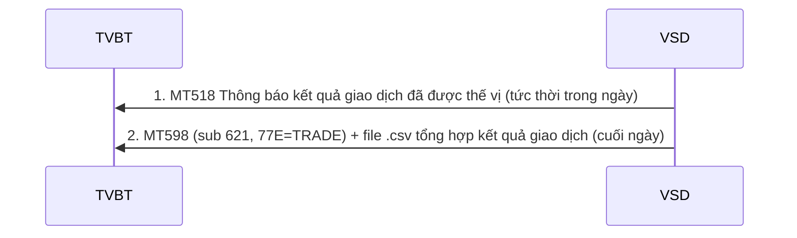
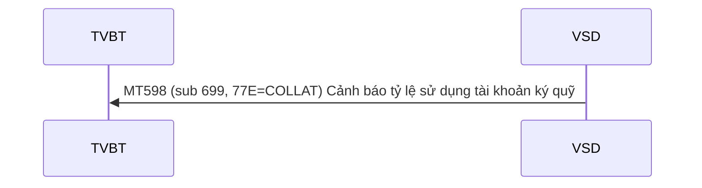
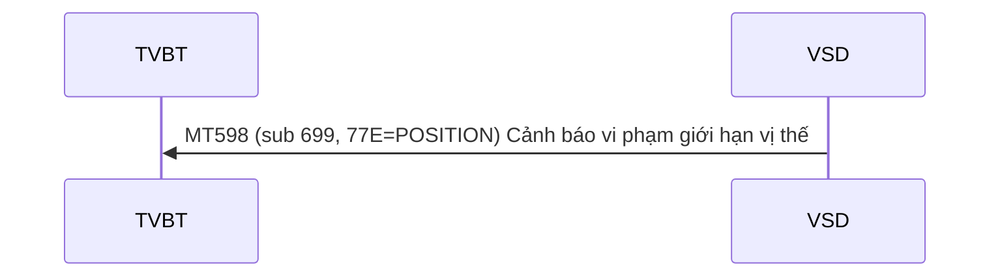
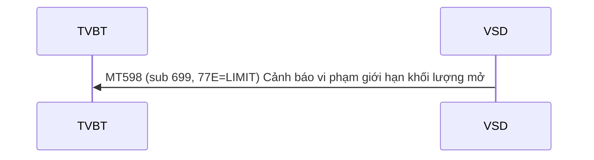
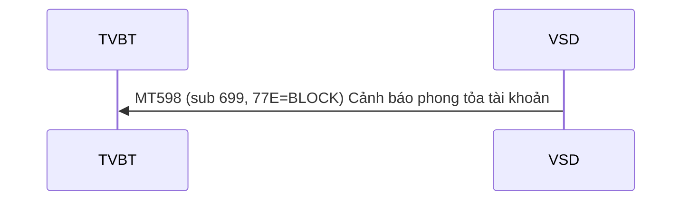
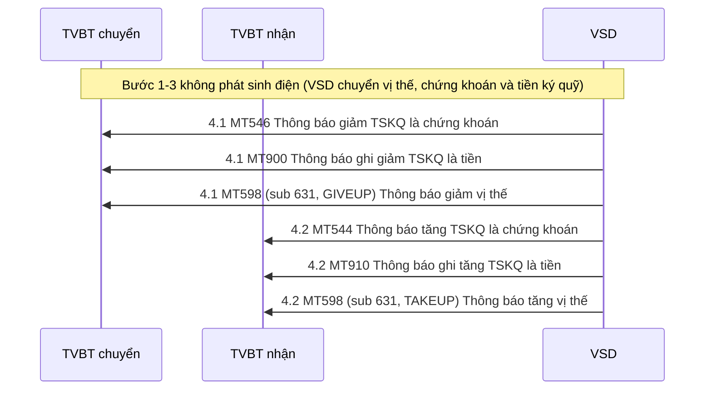
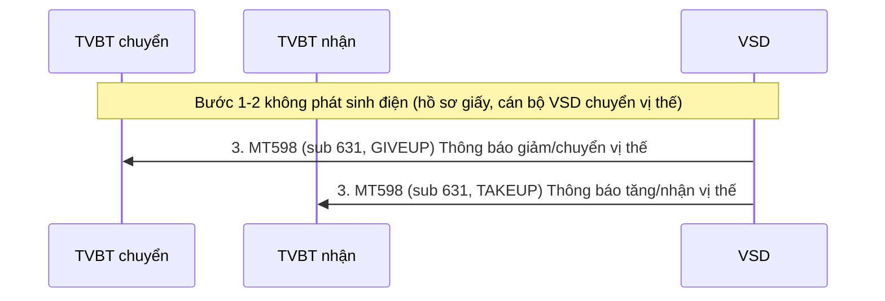
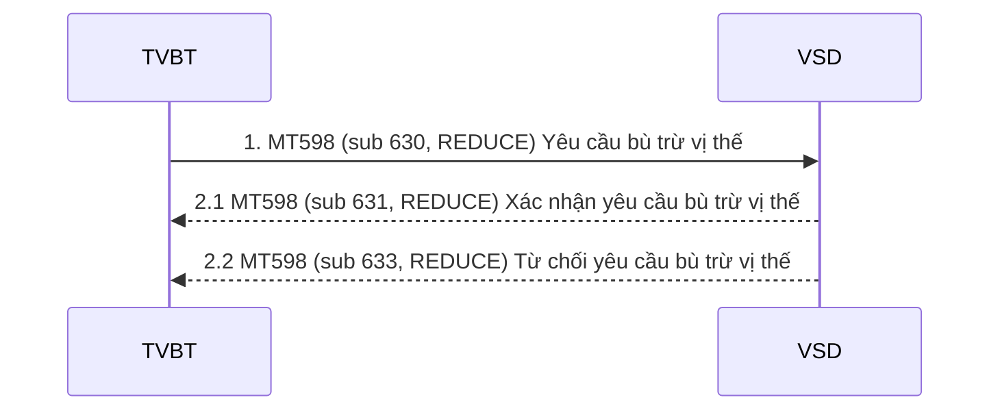

# Nhóm 3 — Bù trừ và quản lý vị thế

> Nguồn: Phụ lục 06 (QĐ 115/QĐ-VSD ngày 31/05/2017) — Phần II, mục 3 (3.1–3.8). Nội dung chuyển thể nguyên văn từ file Word `Phu-luc-06.docx`; tra cứu thuật ngữ tại [00-tong-quan-va-thuat-ngu.md](../00-tong-quan-va-thuat-ngu.md).

## 3.1. VSD thông báo kết quả giao dịch CKPS đã được thế vị cho TVBT

Trình tự thực hiện:
- Bước 1: Sau khi nhà đầu tư giao dịch thành công trên Sở giao dịch, kết quả giao dịch được gửi tức thời cho VSD để thế vị, sau khi thực hiện thế vị, VSD sẽ gửi điện MT518 cho từng TVBT về kết quả giao dịch được thế vị. Nếu lệnh khớp của cùng một TVBT thì sẽ chỉ gửi 01 điện MT518 cho TVBT, thông tin bao gồm cả NĐT bên mua và NĐT bên bán;
- Bước 2: Cuối ngày, VSD gửi báo cáo tổng hợp kết quả giao dịch đã được thế vị dưới dạng file .csv về cho TVBT

#### MT518 – Thông báo kết quả giao dịch đã được thế vị

| Status | Tag | Qualifier | Field Name | Description | Content | No. |
|---|---|---|---|---|---|---|
| **Bắt đầu Block: Thông tin chung** | | | | | | |
| `M` | `16R` | `GENL` |  |  |  | 1 |
| `M` | `20C` | `SEME` | Reference | Số hiệu tham chiếu của VSD | `:4!c//16x` | 2 |
| `M` | `23G` |  | Function of the Message | Lấy giá trị NEWM: Thông báo thế vị mới CANC: Hủy thông báo thế vị trước đó | `4!c` | 3 |
| `M` | `22F` | `TRTR` | Indicator | Lấy giá trị là :TRTR//TRAD | `:4!c//4!c` | 4 |
| `M` | `16R` | `LINK` |  |  |  | 5 |
| `M` | `20C` | `PREV` | Reference | Số hiệu tham chiếu của MT518 cần hủy nếu 23G=CANC | `:4!c//16x` | 6 |
| `M` | `16S` | `LINK` |  |  |  | 7 |
| `M` | `16R` | `LINK` |  |  |  | 8 |
| `M` | `20C` | `RELA` | Reference | Số hiệu tham chiếu xử lý ở hệ thống VSD (TRDnnnnnnnnn, 9 digit number) | `:4!c//16x` | 9 |
| `M` | `16S` | `LINK` |  |  |  | 10 |
| `M` | `16R` | `LINK` |  |  |  | 11 |
| `M` | `20C` | `TRRF` | Reference | Tham chiếu khớp lệnh tại exchange | `:4!c//16x` | 12 |
| `M` | `16S` | `LINK` |  |  |  | 13 |
| `M` | `16S` | `GENL` |  |  |  | 14 |
| **Kết thúc Block: Thông tin chung** | | | | | | |
| **Bắt đầu Block: Thông tin xác nhận** | | | | | | |
| `M` | `16R` | `CONFDET` |  |  |  | 15 |
| `M` | `98C` | `TRAD` |  | Thời điểm khớp lệnh | `:4!c//8!n6!n` | 16 |
| `M` | `98A` | `SETT` |  | Ngày hiệu lực | `:4!c//8!n` | 17 |
| `M` | `90B` | `DEAL` | Price | Giá khớp | `:4!c//3!a15d` | 18 |
| `O` | `19A` | `SETT` | Amount | Giá trị khớp | `:4!c//[N]3!a15d` | 19 |
| `M` | `22H` | `BUSE` | Indicator | BUYI for buyer, SELL for seller or CROF for crossing |  | 20 |
| `M` | `22H` | `PAYM` | Indicator | Lấy giá trị APMT |  | 21 |
| `M` | `16R` | `CONFPRTY` |  |  |  | 22 |
| `M` | `95R` | `AFFM` |  | Lấy giá trị VSDSVN06 | `:4!c//34x` | 23 |
| `M` | `16S` | `CONFPRTY` |  |  |  | 24 |
| `M` | `16R` | `CONFPRTY` |  |  |  | 25 |
| `M` | `95R` | `SELL` |  | BICCODE của TVBT nếu TVBT là bên bán Trường hợp TVBT là bên mua thì giá trị của trường này là VSDSVN06 | `:4!c//34x` | 26 |
| `M` | `16S` | `CONFPRTY` |  |  |  | 27 |
| `M` | `16R` | `CONFPRTY` |  |  |  | 28 |
| `M` | `95R` | `BUYR` |  | BICCODE của TVBT nếu TVBT là bên mua Trường hợp TVBT là bên bán thì giá trị của trường này là VSDSVN06 | `:4!c//34x` | 29 |
| `M` | `16S` | `CONFPRTY` |  |  |  | 30 |
| `M` | `36B` | `CONF` |  | Khối lượng CONF//UNIT | `:4!c//4!c/15d` | 31 |
| `M` | `35B` |  |  | Chứng khoán | [ISIN1!e12!c] [/2!a/32x] | 32 |
| `O` | `70E` | `SPRO` |  | Ghi chú | `:4!c//10*35x` | 33 |
| `M` | `16S` | `CONFDET` |  |  |  | 34 |
| **Kết thúc Block: Thông tin xác nhận** | | | | | | |
| **Bắt đầu Block: Thông tin thanh toán** | | | | | | |
| `M` | `16R` | `SETDET` |  |  |  | 35 |
| `M` | `22F` | `SETR` | Indicator | Lấy giá trị :SETR//TRAD | `:4!c//4!c` | 36 |
| **Bắt đầu Block: Thông tin đối tác thanh toán** | | | | | | |
| `M` | `16R` | `SETPRTY` |  |  |  | 37 |
| `M` | `95P` | `DEAG` | Party | BICCODE bên bán |  | 38 |
| `M` | `20C` | `PROC` | Reference | Số hiệu lệnh bên bán |  | 39 |
| `M` | `70D` | `REGI` | Narrative | Thông tin bổ sung về lệnh bên bán | `6*35x` | 40 |
| `M` | `16S` | `SETPRTY` |  |  |  | 41 |
| `M` | `16R` | `SETPRTY` |  |  |  | 42 |
| `M` | `95P` | `REAG` | Party | BICCODE bên mua |  | 43 |
| `M` | `20C` | `PROC` | Reference | Số hiệu lệnh bên mua |  | 44 |
| `M` | `70D` | `REGI` | Narrative | Thông tin bổ sung về lệnh bên mua | `6*35x` | 45 |
| `M` | `16S` | `SETPRTY` |  |  |  | 46 |
| **Kết thúcBlock: Thông tin đối tác thanh toán** | | | | | | |
| `M` | `16S` | `SETDET` |  |  |  | 47 |
| **Kết thúc Block: Thông tin thanh toán** | | | | | | |

#### MT598 – Thông báo tổng hợp kết quả giao dịch được thế vị cuối ngày

| Status | Tag | Qualifier | Field Name | Description | Content | No. |
|---|---|---|---|---|---|---|
| `M` | `20` |  | Transaction Reference Number | Số hiệu tham chiếu của VSD | `16x` | 1 |
| `M` | `12` |  | Sub-Message Type | Lấy giá trị621 | `3!n` | 2 |
| `M` | `77E` |  | Proprietary Message | Lấy giá trị TRADE | `73x` | 3 |
| **Bắt đầu Block: Thông tin chung** | | | | | | |
| `M` | `16R` | `GENL` |  |  |  | 4 |
| `M` | `23G` | `NEWM` | Function of the message | Lấy giá trị NEWM | `4!c` | 5 |
| `M` | `98A` | `PREP` | Preparation Date | Ngày tạo báo cáo | `:4!c//8!n` | 6 |
| `M` | `16R` | `LINK` |  |  |  | 7 |
| `M` | `20C` | `PREV` | Report Reference | Tên file .csv báo cáo | `:4!c//16x` | 8 |
| `M` | `16S` | `LINK` |  |  |  | 9 |
| `M` | `20C` | `STAT` | Report Reference | The name of the report, date-name-recipient [Date]\_[Report name]\_[Recipient] e.g: • 20160323\_Trade\_001 | `:4!c//35x` | 10 |
| `M` | `16S` | `GENL` |  |  |  | 11 |
| **Kết thúc Block: Thông tin chung** | | | | | | |

Cấu trúc file .csv kết quả khớp lệnh:

Các thông tin thể hiện trên file gồm: Mã CKPS, Số TKGD cho mục đích kỹ quỹ, số hiệu TVBT, thời điểm khớp lệnh, giá khớp lệnh, số lượng.

Cấu trúc file .par gửi kèm với báo cáo kết quả khớp lệnh như sau:

| Tên | Loại dữ liệu | Ghi chú - Độ dài hoặc giá trị cho phép |
|---|---|---|
| SwiftTime | DateTime | &lt;!SWIFTTIME&gt; Thời điểm xử lý tại VSD Gateway ISO 8601 datetime format &lt;YYYY-MM-DD&gt;T&lt;HH:MM&gt; Ví dụ: 2007-04-05T14:30 |
| NonRep | Boolean | Mặc định là FALSE string matches "FALSE" | "TRUE" |
| DeliveryTime | DateTime | &lt;!DELIVERTIME&gt; Thời điểm truyền dữ liệu ISO 8601 datetime format |
| MsgId | String | &lt;!STPREFSEQID&gt; Số sequence do VSDGateway tạo ra string length &lt;= 40 |
| Creationtime | DateTime | &lt;$FILECREATETIME&gt; Thời điểm tạo tệp tin dữ liệu (thuộc tính của file dữ liệu) ISO 8601 datetime format |
| PDIndication | Boolean | Mặc định là FALSE string matches "FALSE" | "TRUE" |
| Requestor | UserDN | Thông tin bên gửi (BICCODE của VSD, lấy giá trị là VSDSVN06) o=&lt;$VSDBICCODE&gt;, o=swift string length &lt;= 100 |
| Responder | UserDN | Thông tin bên nhận (BICCODE của TVBT) o=&lt;$MEMBERBICCODE&gt;, o=swift string length &lt;= 100 |
| Service | String | Mặc định là: swift.corp.fast string length &lt;= 30 |
| RequestType | String | Mặc định là camt.xxx.fisp.rep string length &lt;= 30 |
| Priority | String | Mặc định là Normal string matches "Normal" | "Urgent" |
| RequestRef | String | &lt;$REFREQID&gt; Là giá trị trường 20 của điện MT598 kèm theo string length &lt;= 30 |
| TransferRef | String | &lt;$EVENTCODE&gt; Lấy giá trị là TRADE string length &lt;= 30 |
| TransferDescription | String | &lt;$EVENTNAME&gt; string matches any\* length &lt;= 256 octet |
| TransferInfo | String | &lt;$MEMBERBICCODE&gt;.TRADE.&lt;$SYSDATE&gt;.&lt;$ RequestRef &gt; string matches US ASCII\* length &lt;= 256 |
| PossibleDuplicate | Boolean | Mặc định là TRUE string matches "FALSE" | "TRUE" |
| OrigTransferRef | String | Số reference của hệ thống VSD gửi ra string length &lt;= 30 |
| AckIndicator | Boolean | Mặc định là FALSE string matches "FALSE" | "TRUE" |
| LogicalName |  | Tên tệp tin dữ liệu Sw filename |
| FileDescription | String | Mô tả thêm (có thể không dùng) string matches any\* length &lt;= 256 octet |
| FileInfo | String | Mặc định: SwCompression=None string matches US ASCII\* length &lt;= 256 |
| Size |  | &lt;$FILESIZE&gt; Kích thước tệp tin dữ liệu integer &lt;= 0 |
| SNLId | String | string length &lt;= 30 |
| SNLEP | String | string length &lt;= 15 |
| AckResponder | UserDN | &lt;Không dùng&gt; string length &lt;= 100 |
| AckRequestType | String | &lt;Không dùng&gt; string length &lt;= 30 |
| DigestAlgorithm | String | &lt;Không dùng&gt; string matches "SHA-1" | "SHA-256" |
| DigestValue | String | &lt;Không dùng&gt; string length &lt;= 50 |

## 3.2. Cảnh báo vi phạm tỷ lệ sử dụng tài khoản ký quỹ

VSD thực hiện giám sát tỷ lệ sử dụng tài sản ký quỹ theo thời gian thực (giá trị ký quỹ duy trì yêu cầu/ giá trị tài sản ký quỹ hợp lệ) đồng thời quy định các ngưỡng cảnh báo. Khi tỷ lệ sử dụng tài sản ký quỹ chạm ngưỡng cảnh báo, VSD sẽ tức thời cảnh báo cho TVBT bằng điện MT598.

#### MT598 – Cảnh báo tỷ lệ sử dụng tài khoản ký quỹ

| Status | Tag | Qualifier | Field Name | Description | Content | No. |
|---|---|---|---|---|---|---|
| `M` | `20` |  | Transaction Reference Number | Số hiệu tham chiếu của VSD | `16x` | 1 |
| `M` | `12` |  | Sub-Message Type | Lấy giá trị 699 | `3!n` | 2 |
| `M` | `77E` |  | Proprietary Message | Lấy giá trị COLLAT | `73x` | 3 |
| **Bắt đầu Block: Thông tin chung** | | | | | | |
| `M` | `16R` | `GENL` |  |  |  | 4 |
| `M` | `70D` | `EXPO` | Account Status | Y = Tài khoản hoạt động bình thường X = Dừng giao dịch tài khoản S = Dừng giao dịch mã chứng khoán 1 = Cảnh báo mức 1 2 = Cảnh báo mức 2 | `4!c//1!c` | 5 |
| `O` | `97A` | `SAFE` | Account | Tài khoản ký quỹ của NĐT | `:4!c//35x` | 6 |
| `O` | `35B` |  |  | Mã chứng khoán phái sinh | `[ISIN1!e12!c] [/2!a/32x]` | 7 |
| **Bắt đầu Block: BCOL** | | | | | | |
| `O` | `16R` | `BCOL` |  |  |  | 8 |
| `M` | `19B` | `TEXA` | Amount | Giá trị ký quỹ yêu cầu | `4!c//3!a15d` | 9 |
| `M` | `19B` | `MRKT` | Amount | Tổng giá trị tài sản ký quỹ | `4!c//3!a15d` | 10 |
| `M` | `19B` | `RECA` | Amount | Giá trị tài sản lý quỹ hợp lệ | `4!c//3!a15d` | 11 |
| `O` | `16S` | `BCOL` |  |  |  | 12 |
| **Kết thúc Block: BCOL** | | | | | | |
| `M` | `98A` | `PREP` | Preparation Date | Ngày lập điện | `:4!c//8!n` | 13 |
| `M` | `16S` | `GENL` |  |  |  | 14 |
| **Kết thúc Block: Thông tin chung** | | | | | | |

## 3.3. Cảnh báo vi phạm giới hạn vị thế

Giới hạn vị thế là số lượng hợp đồng tối đa đối với một sản phẩm chứng khoán phái sinh mà một tài khoản được phép nắm giữ. VSD thực hiện giám sát giới hạn vị thế theo thời gian thực và cảnh báo tức thời nếu số lượng vị thế trên tài khoản vi phạm các ngưỡng cảnh báo giới hạn vị thế.

Hệ thống của VSD sẽ tự động gửi cảnh báo bằng điện MT598 khi tài khoản của NĐT vi phạm các ngưỡng cảnh báo.

#### MT598 – Cảnh báo vi phạm giới hạn vị thế

| Status | Tag | Qualifier | Field Name | Description | Content | No. |
|---|---|---|---|---|---|---|
| `M` | `20` |  | Transaction Reference Number | Số hiệu tham chiếu của VSD | `16x` | 1 |
| `M` | `12` |  | Sub-Message Type | Lấy giá trị 699 | `3!n` | 2 |
| `M` | `77E` |  | Proprietary Message | Lấy giá trị:POSITION | `73x` | 3 |
| **Bắt đầu Block: Thông tin chung** | | | | | | |
| `M` | `16R` | `GENL` |  |  |  | 4 |
| `M` | `70D` | `EXPO` | Account Status | Y = Tài khoản hoạt động bình thường X = Dừng giao dịch tài khoản S = Dừng giao dịch mã chứng khoán 1 = Cảnh báo mức 1 2 = Cảnh báo mức 2 | `4!c//1!c` | 5 |
| `O` | `97A` | `SAFE` | Account | Tài khoản ký quỹ của NĐT | `:4!c//35x` | 6 |
| `O` | `35B` |  |  | Mã chứng khoán phái sinh | `[ISIN1!e12!c] [/2!a/32x]` | 7 |
| **Bắt đầu Block: SCOL** | | | | | | |
| `O` | `16R` | `SCOL` |  | Chỉ áp dụng cho 77E =POSITION |  | 8 |
| `M` | `36B` | `SECV` |  | UNIT = Số lượng vị thế hiện tại | `4!c//4!c/15d` | 9 |
| `M` | `36B` | `COLL` |  | UNIT = Số lượng vị thế tối đa | `4!c//4!c/15d` | 10 |
| `O` | `16S` | `SCOL` |  |  |  | 11 |
| **Kết thúc Block: BCOL/SCOL** | | | | | | |
| `M` | `98A` | `PREP` | Preparation Date | Ngày lập điện | `:4!c//8!n` | 12 |
| `M` | `16S` | `GENL` |  |  |  | 13 |
| **Kết thúc Block: Thông tin chung** | | | | | | |

## 3.4. Cảnh báo vi phạm giới hạn khối lượng mở

VSD thiết lập và giám sát tỷ lệ giữa số vị thế TVBT nắm giữ tổng khối lượng mở (OI) của toàn thị trường. Hệ thống VSD sẽ gửi cảnh báo tức thời ngay khi số lượng vị thế của bất kỳ tài khoản nào vi phạm giới hạn về khối lượng mở. Hệ thống của VSD sẽ tự động gửi cảnh báo bằng điện MT598 khi tỷ lệ nói trên vi phạm giới hạn, ngưỡng cảnh báo do VSD thiết lập.

#### MT598 – Cảnh báo vi phạm giới hạn khối lượng mở

| Status | Tag | Qualifier | Field Name | Description | Content | No. |
|---|---|---|---|---|---|---|
| `M` | `20` |  | Transaction Reference Number | Số hiệu tham chiếu của VSD | `16x` | 1 |
| `M` | `12` |  | Sub-Message Type | Lấy giá trị 699 | `3!n` | 2 |
| `M` | `77E` |  | Proprietary Message | Lấy giá trị:LIMIT | `73x` | 3 |
| **Bắt đầu Block: Thông tin chung** | | | | | | |
| `M` | `16R` | `GENL` |  |  |  | 4 |
| `M` | `70D` | `EXPO` | Account Status | Y = Tài khoản hoạt động bình thường X = Dừng giao dịch tài khoản S = Dừng giao dịch mã chứng khoán 1 = Cảnh báo mức 1 2 = Cảnh báo mức 2 | `4!c//1!c` | 5 |
| `O` | `97A` | `SAFE` | Account | Tài khoản ký quỹ của NĐT | `:4!c//35x` | 6 |
| `O` | `35B` |  |  | Mã chứng khoán phái sinh | `[ISIN1!e12!c] [/2!a/32x]` | 7 |
| **Bắt đầu Block: SCOL** | | | | | | |
| `O` | `16R` | `SCOL` |  | Chỉ áp dụng cho 77E =LIMIT |  | 8 |
| `M` | `36B` | `SECV` |  | UNIT = Số lượng vị thế hiện tại | `4!c//4!c/15d` | 9 |
| `M` | `36B` | `COLL` |  | UNIT = Số lượng vị thế tối đa | `4!c//4!c/15d` | 10 |
| `O` | `16S` | `SCOL` |  |  |  | 11 |
| **Kết thúc Block:SCOL** | | | | | | |
| `M` | `98A` | `PREP` | Preparation Date | Ngày lập điện | `:4!c//8!n` | 12 |
| `M` | `16S` | `GENL` |  |  |  | 13 |
| **Kết thúc Block: Thông tin chung** | | | | | | |

## 3.5. Cảnh báo phong tỏa tài khoản

#### MT598 – Cảnh báo phong tỏa tài khoản

| Status | Tag | Qualifier | Field Name | Description | Content | No. |
|---|---|---|---|---|---|---|
| `M` | `20` |  | Transaction Reference Number | Số hiệu tham chiếu của VSD | `16x` | 1 |
| `M` | `12` |  | Sub-Message Type | Lấy giá trị 699 | `3!n` | 2 |
| `M` | `77E` |  | Proprietary Message | Lấy giá trị:BLOCK | `73x` | 3 |
| **Bắt đầu Block: Thông tin chung** | | | | | | |
| `M` | `16R` | `GENL` |  |  |  | 4 |
| `M` | `70D` | `EXPO` | Account Status | Y = Tài khoản hoạt động bình thường X = Dừng giao dịch tài khoản S = Dừng giao dịch mã chứng khoán 1 = Cảnh báo mức 1 2 = Cảnh báo mức 2 | `4!c//1!c` | 5 |
| `O` | `97A` | `SAFE` | Account | Tài khoản ký quỹ của NĐT | `:4!c//35x` | 6 |
| `M` | `98A` | `PREP` | Preparation Date | Ngày lập điện | `:4!c//8!n` | 7 |
| `M` | `16S` | `GENL` |  |  |  | 8 |
| **Kết thúc Block: Thông tin chung** | | | | | | |

## 3.6. Chuyển khoản tất toán vị thế, ký quỹ

Trình tự thực hiện:

Trong trường hợp nhà đầu tư thay đổi TVBT, thứ tự các bước thực hiện:
- Bước 1: Đăng ký thông tin tài khoản giao dịch cho mục đích ký quỹ và giao dịch mới tại TVBT mới (nếu chưa có)
- Bước 2: TVBT bên chuyển gửi hồ sơ lên VSD yêu cầu chuyển khoản tất toán vị thế và tài sản ký quỹ  từ TVBT bên chuyển sang TVBT bên nhận
- Bước 3: Cán bộ VSD thực hiện
- Chuyển khoản vị thế của nhà đầu tư từ tài khoản giao dịch CKPS tại TVBT bên chuyển sang tài khoản giao dịch CKPS tại TVBT bên nhận;
- Chuyển khoản chứng khoán và thông báo cho Ngân hàng thanh toán chuyển khoản tiền ký quỹ của nhà đầu tư từ tài khoản tiền ký quỹ của TVBT bên chuyển (đứng tên VSD) sang tài khoản tiền ký quỹ của TVBT bên nhận (đứng tên VSD) mở tại NHTT.

(Bước 1, 2, 3 không phát sinh điện giữa VSD và TVBT)
- Bước 4: VSD gửi điện dưới đây cho TVBT liên quan thông báo về:

4.1.  MT546  đồng thời với MT900 cho TVBT bên chuyển việc ghi giảm tài sản ký quỹ của nhà đầu tư.
-  MT598 cho TVBT bên chuyển về việc ghi giảm vị thế trên tài khoản của nhà đầu tư

4.2. MT544 đồng thời với MT910 cho TVBT bên nhận việc ghi tăng tài sản ký quỹ của nhà đầu tư.
-  MT598 cho TVBT bên nhận về việc ghi tăng vị thế trên tài khoản của nhà đầu tư

#### MT546 –Thông báo giảm tài sản ký quỹ là chứng khoán

| Status | Tag | Qualifier | Field Name | Description | Content | No. |
|---|---|---|---|---|---|---|
| **Bắt đầu Block: Thông tin chung** | | | | | | |
| `M` | `16R` | `GENL` |  |  |  | 1 |
| `M` | `20C` | `SEME` | Reference | Số hiệu của tham chiếu của VSD | `:4!c//16x` | 2 |
| `M` | `23G` | `NEWM` | Function of the Message | Lấy giá trị NEWM | `4!c` | 3 |
| `O` | `98A` | `PREP` | Preparation Date | Ngày tạo | `:4!c//8!n` | 4 |
| `O` | `16R` | `LINK` |  |  |  | 5 |
| `M` | `20C` | `RELA` | Relation | Số tham chiếu hệ thống phái sinh | `:4!c//16x` | 6 |
| `O` | `16S` | `LINK` |  |  |  | 7 |
| `M` | `16S` | `GENL` |  |  |  | 8 |
| **Kết thúc Block: Thông tin chung** | | | | | | |
| **Bắt đầu Block: Thông tin chuyển khoản** | | | | | | |
| `M` | `16R` | `TRADDET` |  |  |  | 9 |
| `M` | `98A` | `ESET` | Date | Ngày hạch toán | `:4!c//8!n` | 10 |
| `M` | `35B` |  | Identification of the Financial Instrument | Chứng khoán (chứng khoán phái sinh và chứng khoán làm tài sản ký quỹ) | [ISIN1!e12!c] [/2!a/32x] | 11 |
| `O` | `70E` | `SPRO` |  | Ghi chú | `:4!c//10*35x` | 12 |
| `M` | `16S` | `TRADDET` |  |  |  | 13 |
| **Kết thúc Block: Thông tin chuyển khoản** | | | | | | |
| **Bắt đầu Block: Thông tin tài khoản chuyển** | | | | | | |
| `M` | `16R` | `FIAC` |  |  |  | 14 |
| `M` | `36B` | `ESTT` | Quantity | Khối lượng Giá trị của qualifier :ESTT//UNIT, sử dụng cho cổ phiếu, chứng chỉ quỹ, chứng khoán phái sinh :ESTT//FAMT, sử dụng cho trái phiếu | `:4!c//4!c/15d` | 15 |
| `M` | `95P` | `ACOW` | Party | BICCODE của TVBT bên chuyển | `:4!c//4!a2!a2!c[3c]` | 16 |
| `M` | `97A` | `SAFE` | Account | Tài khoản bên chuyển | `:4!c//35x` | 17 |
| `M` | `16S` | `FIAC` |  |  |  | 18 |
| **Kết thúc Block: Thông tin tài khoản chuyển** | | | | | | |
| **Bắt đầu Block: Thông tin tài khoản nhận** | | | | | | |
| `M` | `16R` | `SETDET` |  |  |  | 19 |
| `M` | `22F` | `SETR` | Indicator | Lấy giá trị là :SETR//COLO | `:4!c//4!c` | 20 |
| `M` | `22F` | `STCO` |  | Lấy giá trị là :STCO//DRAW | `:4!c//4!c` | 21 |
| `M` | `16R` | `SETPRTY` |  |  |  | 22 |
| `M` | `95P` | `PSET` | Party | Lấy giá trị là: VSDSVN06 | `:4!c//4!a2!a2!c[3c]` | 23 |
| `O` | `20C` | `PROC` | Reference |  | `:4!c//16x` | 24 |
| `M` | `16S` | `SETPRTY` |  |  |  | 25 |
| `M` | `16R` | `SETPRTY` |  |  |  | 26 |
| `M` | `95P` | `REAG` | Party | BICCODE của TVBT bên nhận | `:4!c//4!a2!a2!c[3c]` | 27 |
| `M` | `97A` | `SAFE` | Account | Số tài khoản bên nhận | `:4!c//35x` | 28 |
| `M` | `16S` | `SETPRTY` |  |  |  | 29 |
| `M` | `16S` | `SETDET` |  |  |  | 30 |
| **Kết thúc Block: Thông tin tài khoản nhận** | | | | | | |

#### MT544 - Thông báo tăng tài sản ký quỹ là chứng khoán

| Status | Tag | Qualifier | Field Name | Description | Content | No. |
|---|---|---|---|---|---|---|
| **Bắt đầu Block: Thông tin chung** | | | | | | |
| `M` | `16R` | `GENL` |  |  |  | 1 |
| `M` | `20C` | `SEME` | Reference | Số hiệu tham chiếu của VSD | `:4!c//16x` | 2 |
| `M` | `23G` |  | Function of the Message | Lấy giá trị NEWM | `4!c` | 3 |
| `O` | `98A` | `PREP` | Preparation Date/ | Ngày tạo | `:4!c//8!n` | 4 |
| `O` | `16R` | `LINK` |  |  |  | 5 |
| `M` | `20C` | `RELA` | Relation | Số tham chiếu hệ thống phái sinh | `:4!c//16x` | 6 |
| `O` | `16S` | `LINK` |  |  |  | 7 |
| `M` | `16S` | `GENL` |  |  |  | 8 |
| **Kết thúc Block: Thông tin chung** | | | | | | |
| **Bắt đầu Block: Thông tin giao dịch** | | | | | | |
| `M` | `16R` | `TRADDET` |  |  |  | 9 |
| `M` | `98A` | `ESET` |  | Ngày hiệu lực | `:4!c//8!n` | 10 |
| `M` | `35B` |  |  | Chứng khoán | [ISIN1!e12!c] [/2!a/32x] | 11 |
| `O` | `70E` | `SPRO` |  | Ghi chú | `:4!c//10*35x` | 12 |
| `M` | `16S` | `TRADDET` |  |  |  | 13 |
| **Kết thúc Block: Thông tin giao dịch** | | | | | | |
| **Bắt đầu Block: Thông tin chi tiết** | | | | | | |
| `M` | `16R` | `FIAC` |  |  |  | 14 |
| `M` | `36B` | `ESTT` | Quantity of financial instrument | Khối lượng Giá trị của qualifier :ESTT//UNIT, sử dụng cho cổ phiếu, chứng chỉ quỹ, chứng khoán phái sinh :ESTT//FAMT, sử dụng cho trái phiếu | `:4!c//4!c/15d` | 15 |
| `M` | `95P` | `ACOW` | Party | BICCODE của TVBT nhận chuyển khoản | `:4!c//4!a2!a2!c[3c]` | 16 |
| `M` | `97A` | `SAFE` |  | Tài khoản của nhà đầu tư nhận chuyển khoản | `:4!c//35x` | 17 |
| `M` | `16S` | `FIAC` |  |  |  | 18 |
| **Kết thúc Block: Thông tin chi tiết** | | | | | | |
| **Bắt đầu Block: Thanh toán chi tiết** | | | | | | |
| `M` | `16R` | `SETDET` |  |  |  | 19 |
| `M` | `22F` | `SETR` |  | Lấy giá trị là :SETR//COLI | `:4!c//4!c` | 20 |
| `M` | `22F` | `STCO` |  | Lấy giá trị là :STCO//DRAW | `:4!c//4!c` | 21 |
| `M` | `16R` | `SETPRTY` |  |  |  | 22 |
| `M` | `95P` | `PSET` | Place of settlement | Lấy giá trị VSDSVN06 | `:4!c//4!a2!a2!c[3!c]` | 23 |
| `M` | `16S` | `SETPRTY` |  |  |  | 24 |
| `M` | `16R` | `SETPRTY` |  |  |  | 25 |
| `M` | `95P` | `DEAG` |  | BICCODE của TVBT bên chuyển | `:4!c//4!a2!a2!c[3c]` | 26 |
| `M` | `97A` | `SAFE` | Account | Tài khoản bên chuyển | `:4!c//35x` | 27 |
| `M` | `16S` | `SETPRTY` |  |  |  | 28 |
| `M` | `16S` | `SETDET` |  | End of  block SETDET |  | 29 |
| **Kết thúc Block: Thanh toán chi tiết** | | | | | | |

#### MT900 –Thông báo ghi giảm tài sản ký quỹ là tiền của bên chuyển

| Status | Tag | Qualifier | Field Name | Description | Content | No. |
|---|---|---|---|---|---|---|
| `M` | `20` |  | Transaction Reference Number | Số hiệu tham chiếu của VSD | `16x` | 1 |
| `M` | `21` |  | Related Reference | Số hiệu tham chiếu của ngân hàng | `16x` | 2 |
| `M` | `25` |  | Account Identification | Số tài khoản của TVBT tại ngân hàng ghi giảm Là tài khoản BICCODE.C | `35x` | 3 |
| `M` | `32A` |  | Value Date, Currency, Amount | Ngày giao dịch Loại tiền Số tiền | `6!n3!a15d` | 4 |
| `M` | `52A` |  |  | BICCODE của TVBT | `:4!c//4!a2!a2!c[3!c]` | 5 |
| `M` | `72` |  | Sender to Receiver information | AT//Số tài khoản ký quỹ của NĐT chuyển/Số tài khoản ký quỹ của NĐT nhận | `6*35x` | 6 |

#### MT910 –Thông báo ghi tăng tài sản ký quỹ là tiền bên nhận

| Status | Tag | Qualifier | Field Name | Description | Content | No. |
|---|---|---|---|---|---|---|
| `M` | `20` |  | Transaction Reference Number | Số hiệu tham chiếu của VSD | `16x` | 1 |
| `M` | `21` |  | Related Reference | Số hiệu tham chiếu của ngân hàng | `16x` | 2 |
| `M` | `25` |  | Account Identification | Số tài khoản tại ngân hàng được ghi tăng số dư Là tài khoản BICCODE.C | `35x` | 3 |
| `M` | `32A` |  | Value Date, Currency, Amount | Ngày giao dịch Loại tiền Số tiền | `6!n3!a15d` | 4 |
| `M` | `52A` |  |  | BICCODE của TVBT | `:4!c//4!a2!a2!c[3!c]` | 5 |
| `M` | `72` |  | Sender to Receiver information | AT//Số tài khoản ký quỹ của NĐT chuyển/Số tài khoản ký quỹ của NĐT nhận | `6*35x` | 6 |

#### MT598 –Thông báo tăng/giảm vị thế

| Status | Tag | Qualifier | Field Name | Description | Content | No. |
|---|---|---|---|---|---|---|
| `M` | `20` |  | Transaction Reference Number | Số hiệu tham chiếu của VSD | `16x` | 1 |
| `M` | `12` |  | Sub-Message Type | Lấy giá trị 631 | `3!n` | 2 |
| `M` | `77E` |  | Proprietary Message | Lấy giá trị: • GIVEUP • TAKEUP | `73x` | 3 |
| `M` | `16R` | `GENL` |  |  |  | 4 |
| `M` | `97A` | `SAFE` | Account | Số tài khoản ký quỹ của NĐT | `:4!c//35x` | 5 |
| `M` | `35B` |  |  | Mã chứng khoán phái sinh | `[ISIN1!e12!c] [/2!a/32x]` | 6 |
| `M` | `70E` | `SPRO` | Position quantities | Tối đa 02 dòng. 4!c thứ hai lấy một trong các giá trị sau LFUT=long, SFUT=short Ví dụ :70E://SPRO/LFUT/40 SFUT/30 | `:4!c//4*35x` | 7 |
| `M` | `90B` | `DEAL` | Average price | 4!c thứ hai lấy một trong các giá trị sau LFUT=long, SFUT=short Ví dụ DEAL//LFUT/VND/123 DEAL//SFUT/VND/123 Ghi chú: trường hợp không có long hoặc short thì giá sẽ là 0 VD DEAL//SFUT/VND/0 | `4!c//4!c/3!a/15d` | 8 |
| `O` | `98A` | `PREP` | Preparation Date | Ngày xác nhận (YYYYMMDD) | `:4!c//8!n` | 9 |
| `O` | `16R` | `LINK` |  |  |  | 10 |
| `M` | `20C` | `RELA` |  | Link đến trường 20 của điện yêu cầu bù trừ vị thế | `:4!c//16x` | 11 |
| `O` | `16S` | `LINK` |  |  |  | 12 |
| `M` | `16S` | `GENL` |  |  |  | 13 |

## 3.7. Chuyển khoản vị thế

Trình tự thực hiện:

Trong trường hợp nhà đầu tư có nhiều tài khoản giao dịch cho mục đích ký quỹ tại nhiều TVBT khác nhau và có nhu cầu chuyển khoản vị thế giữa các tài khoản này thì thực hiện theo trình tự sau:
- Bước 1: TVBT lập hồ sơ yêu cầu thực hiện chuyển khoản vị thế gửi lên VSD
- Bước 2: Cán bộ VSD thực hiện chuyển khoản vị thế giữa hai tài khoản giao dịch CKPS trên hệ thống của VSD

(Bước 1, 2 không phát sinh điện giữa VSD và TVBT)
- Bước 3: Sau khi thực hiện chuyển khoản, VSD sẽ gửi điện dưới đây cho TVBT liên quan thông báovề:
-  MT598 cho TVBT bên chuyển về việc ghi giảm vị thế trên tài khoản của nhà đầu tư
-  MT598 cho TVBT bên nhận về việc ghi tăng vị thế trên tài khoản của nhà đầu tư

#### MT598 –Thông báo tăng/giảm vị thế

| Status | Tag | Qualifier | Field Name | Description | Content | No. |
|---|---|---|---|---|---|---|
| `M` | `20` |  | Transaction Reference Number | Số hiệu tham chiếu của VSD | `16x` | 1 |
| `M` | `12` |  | Sub-Message Type | Lấy giá trị 631 | `3!n` | 2 |
| `M` | `77E` |  | Proprietary Message | Lấy giá trị: • GIVEUP • TAKEUP | `73x` | 3 |
| `M` | `16R` | `GENL` |  |  |  | 4 |
| `M` | `97A` | `SAFE` | Account | Số tài khoản ký quỹ của NĐT | `:4!c//35x` | 5 |
| `M` | `35B` |  |  | Mã chứng khoán phái sinh | `[ISIN1!e12!c] [/2!a/32x]` | 6 |
| `M` | `70E` | `SPRO` | Position quantities | Tối đa 02 dòng. 4!c thứ hai lấy một trong các giá trị sau LFUT=long, SFUT=short Ví dụ :70E://SPRO/LFUT/40 SFUT/30 | `:4!c//4*35x` | 7 |
| `M` | `90B` | `DEAL` | Average price | 4!c thứ hai lấy một trong các giá trị sau LFUT=long, SFUT=short Ví dụ DEAL//LFUT/VND/123 DEAL//SFUT/VND/123 Ghi chú: trường hợp không có long hoặc short thì giá sẽ là 0 VD DEAL//SFUT/VND/0 | `4!c//4!c/3!a/15d` | 8 |
| `O` | `98A` | `PREP` | Preparation Date | Ngày xác nhận (YYYYMMDD) | `:4!c//8!n` | 9 |
| `O` | `16R` | `LINK` |  |  |  | 10 |
| `M` | `20C` | `RELA` |  | Link đến trường 20 của điện yêu cầu bù trừ vị thế | `:4!c//16x` | 11 |
| `O` | `16S` | `LINK` |  |  |  | 12 |
| `M` | `16S` | `GENL` |  |  |  | 13 |

## 3.8. Bù trừ vị thế trên tài khoản tổng hợp (Omnibus account)

Trình tự thực hiện:

Trong trường hợp nhà đầu tư được phép mở tài khoản tổng hợp (omnibus account), các vị thế mua bán của cùng một sản phẩm chứng khoán phái sinh có cùng tháng đáo hạn vẫn được duy trì trên tài khoản giao dịch CKPS. Khi có nhu cầu đóng bớt vị thế, TVBT có thể yêu cầu VSD bù trừ vị thế trên tài khoản tổng hợp này.

Trình tự thực hiện:
- Bước 1; TVBT gửi điện M598 yêu cầu bù trừ (chỉ định các cặp vị thế sẽ được bù trừ)
- Bước 2: Cán bộ VSD kiểm tra xử lý và gửi trả kết quả:

2.1. Xác nhận yêu cầu bù trừ vị thế bằng điện MT598 (giá trị trường 12 là 631)

2.2. Từ chối xử lý bằng điện MT598 (giá trị của trường 12 là 633)

#### MT598 –Yêu cầu bù trừ vị thế

| Status | Tag | Qualifier | Field Name | Description | Content | No. |
|---|---|---|---|---|---|---|
| `M` | `20` |  | Transaction Reference Number | Số hiệu tham chiếu của TVBT | `16x` | 1 |
| `M` | `12` |  | Sub-Message Type | Lấy giá trị 630 | `3!n` | 2 |
| `M` | `77E` |  | Proprietary Message | Lấy giá trị: REDUCE | `73x` | 3 |
| `M` | `16R` | `GENL` |  |  |  | 4 |
| `M` | `97A` | `SAFE` | Account | Số tài khoản ký quỹ của NĐT | `:4!c//35x` | 5 |
| `M` | `35B` |  |  | Mã chứng khoán phái sinh | `[ISIN1!e12!c] [/2!a/32x]` | 6 |
| `M` | `36B` | `SETT` | Quantity of financial instrument | Khối lượng vị thế yêu cầu bù trừ | `:4!c//15d` | 7 |
| `M` | `16S` | `GENL` |  |  |  | 8 |

#### MT598 –Xác nhận yêu cầu bù trừ vị thế

| Status | Tag | Qualifier | Field Name | Description | Content | No. |
|---|---|---|---|---|---|---|
| `M` | `20` |  | Transaction Reference Number | Số hiệu tham chiếu của VSD | `16x` | 1 |
| `M` | `12` |  | Sub-Message Type | Lấy giá trị 631 | `3!n` | 2 |
| `M` | `77E` |  | Proprietary Message | Lấy giá trị: • REDUCE | `73x` | 3 |
| `M` | `16R` | `GENL` |  |  |  | 4 |
| `M` | `97A` | `SAFE` | Account | Số tài khoản ký quỹ của NĐT | `:4!c//35x` | 5 |
| `M` | `35B` |  |  | Mã chứng khoán phái sinh | `[ISIN1!e12!c] [/2!a/32x]` | 6 |
| `M` | `36B` | `SETT` | Quantity of financial instrument | Khối lượng vị thế yêu cầu bù trừ | `:4!c//15d` | 7 |
| `O` | `98A` | `PREP` | Preparation Date | Ngày xác nhận (YYYYMMDD) | `:4!c//8!n` | 8 |
| `M` | `16R` | `LINK` |  |  |  | 9 |
| `M` | `20C` | `RELA` |  | Link đến trường 20 của điện yêu cầu bù trừ vị thế | `:4!c//16x` | 10 |
| `M` | `16S` | `LINK` |  |  |  | 11 |
| `M` | `16S` | `GENL` |  |  |  | 12 |

#### MT598 –Từ chối yêu cầu bù trừ vị thế

| Status | Tag | Qualifier | Field Name | Description | Content | No. |
|---|---|---|---|---|---|---|
| `M` | `20` |  | Transaction Reference Number | Số hiệu tham chiếu của VSD | `16x` | 1 |
| `M` | `12` |  | Sub-Message Type | Lấy giá trị 633 | `3!n` | 2 |
| `M` | `77E` |  | Proprietary Message | Lấy giá trị: • REDUCE | `73x` | 3 |
| `M` | `16R` | `GENL` |  |  |  | 4 |
| `M` | `23G` | `REJT` | Function of the message | Lấy giá trị REJT | `4!c` | 5 |
| `M` | `98A` | `PREP` | Preparation Date | Ngày tạo | `:4!c//8!n` | 6 |
| `M` | `16R` | `LINK` |  |  |  | 7 |
| `M` | `20C` | `RELA` |  | Link đến trường 20 của điện yêu cầu bù trừ vị thế | `:4!c//16x` | 8 |
| `M` | `16S` | `LINK` |  |  |  | 9 |
| `M` | `20C` | `STAT` | Report Reference | Lý do từ chối • Vị thế không có • Khối lượng vị thế nhỏ hơn khối lượng yêu cầu bù trừ | `:4!c//35x` | 10 |
| `M` | `16S` | `GENL` |  |  |  | 11 |

