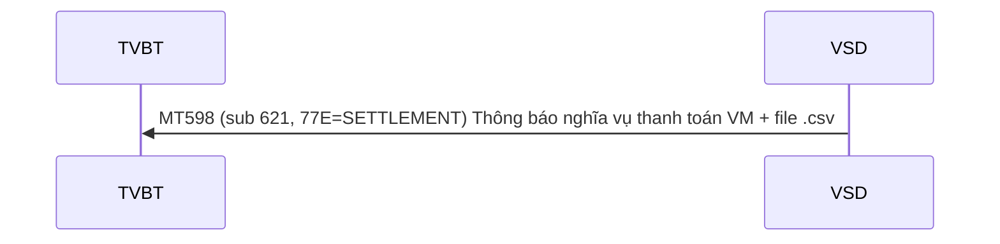
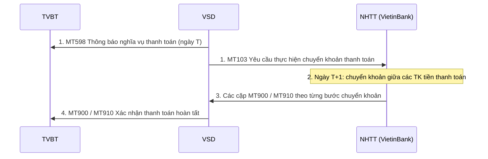

# Nhóm 4 — Thanh toán lãi/lỗ vị thế

> Nguồn: Phụ lục 06 (QĐ 115/QĐ-VSD ngày 31/05/2017) — Phần II, mục 4 (4.1–4.2). Nội dung chuyển thể nguyên văn từ file Word `Phu-luc-06.docx`; tra cứu thuật ngữ tại [00-tong-quan-va-thuat-ngu.md](../00-tong-quan-va-thuat-ngu.md).

## 4.1. VSD thông báo nghĩa vụ thanh toán lãi/lỗ vị thế (VM) cho TVBT

Cuối ngày, VSD tính toán nghĩa vụ thanh toán hàng ngày đối với từng tài khoản NĐT/TVBT; và gửi điện MT598 kèm file csv thông báo nghĩa vụ thanh toán hàng ngày cho TVBT.

#### MT598 – Thông báo nghĩa vụ thanh toán lãi/lỗ vị thế

| Status | Tag | Qualifier | Field Name | Description | Content | No. |
|---|---|---|---|---|---|---|
| `M` | `20` |  | Transaction Reference Number | Số hiệu tham chiếu của VSD | `16x` | 1 |
| `M` | `12` |  | Sub-Message Type | Lấy giá trị621 | `3!n` | 2 |
| `M` | `77E` |  | Proprietary Message | Lấy giá trị SETTLEMENT | `73x` | 3 |
| **Bắt đầu Block: Thông tin chung** | | | | | | |
| `M` | `16R` | `GENL` |  |  |  | 4 |
| `M` | `23G` | `NEWM` | Function of the message | Lấy giá trị NEWM | `4!c` | 5 |
| `M` | `98A` | `PREP` | Preparation Date | Ngày tạo báo cáo | `:4!c//8!n` | 6 |
| `M` | `16R` | `LINK` |  |  |  | 7 |
| `M` | `20C` | `PREV` | Report Reference | Tên file .csv báo cáo | `:4!c//16x` | 8 |
| `M` | `16S` | `LINK` |  |  |  | 9 |
| `M` | `20C` | `STAT` | Report Reference | The name of the report, date-name-recipient [Date]\_[Report name]\_[Recipient] e.g: • 20160323\_Settlement\_001 | `:4!c//35x` | 10 |
| `M` | `16S` | `GENL` |  |  |  | 11 |
| **Kết thúc Block: Thông tin chung** | | | | | | |

Cấu trúc file .csv thông báo nghĩa vụ thanh toán hàng ngày bao gồm các thông tin chi tiết:
- Tài khoản giao dịch cho ký quỹ của NĐT/TVBT
- Giá trị lỗ/lãi ròng tương ứng từng tài khoản.
- Giá trị lỗ/lãi ròng theo TVBT

Cấu trúc file .par gửi kèm với thông báo nghĩa vụ thanh toán hàng ngày như sau:

| Tên | Loại dữ liệu | Ghi chú - Độ dài hoặc giá trị cho phép |
|---|---|---|
| SwiftTime | DateTime | &lt;!SWIFTTIME&gt; Thời điểm xử lý tại VSD Gateway ISO 8601 datetime format &lt;YYYY-MM-DD&gt;T&lt;HH:MM&gt; Ví dụ: 2007-04-05T14:30 |
| NonRep | Boolean | Mặc định là FALSE string matches "FALSE" | "TRUE" |
| DeliveryTime | DateTime | &lt;!DELIVERTIME&gt; Thời điểm truyền dữ liệu ISO 8601 datetime format |
| MsgId | String | &lt;!STPREFSEQID&gt; Số sequence do VSDGateway tạo ra string length &lt;= 40 |
| Creationtime | DateTime | &lt;$FILECREATETIME&gt; Thời điểm tạo tệp tin dữ liệu (thuộc tính của file dữ liệu) ISO 8601 datetime format |
| PDIndication | Boolean | Mặc định là FALSE string matches "FALSE" | "TRUE" |
| Requestor | UserDN | Thông tin bên gửi (BICCODE của VSD, lấy giá trị là VSDSVN06) o=&lt;$VSDBICCODE&gt;, o=swift string length &lt;= 100 |
| Responder | UserDN | Thông tin bên nhận (BICCODE của TVBT) o=&lt;$MEMBERBICCODE&gt;, o=swift string length &lt;= 100 |
| Service | String | Mặc định là: swift.corp.fast string length &lt;= 30 |
| RequestType | String | Mặc định là camt.xxx.fisp.rep string length &lt;= 30 |
| Priority | String | Mặc định là Normal string matches "Normal" | "Urgent" |
| RequestRef | String | &lt;$REFREQID&gt; Là giá trị trường 20 của điện MT598 kèm theo string length &lt;= 30 |
| TransferRef | String | &lt;$EVENTCODE&gt; Lấy giá trị là SETTLEMENT string length &lt;= 30 |
| TransferDescription | String | &lt;$EVENTNAME&gt; string matches any\* length &lt;= 256 octet |
| TransferInfo | String | &lt;$MEMBERBICCODE&gt;.SETTLEMENT.&lt;$SYSDATE&gt;.&lt;$ RequestRef &gt; string matches US ASCII\* length &lt;= 256 |
| PossibleDuplicate | Boolean | Mặc định là TRUE string matches "FALSE" | "TRUE" |
| OrigTransferRef | String | Số reference của hệ thống VSD gửi ra string length &lt;= 30 |
| AckIndicator | Boolean | Mặc định là FALSE string matches "FALSE" | "TRUE" |
| LogicalName |  | Tên tệp tin dữ liệu Sw filename |
| FileDescription | String | Mô tả thêm (có thể không dùng) string matches any\* length &lt;= 256 octet |
| FileInfo | String | Mặc định: SwCompression=None string matches US ASCII\* length &lt;= 256 |
| Size |  | &lt;$FILESIZE&gt; Kích thước tệp tin dữ liệu integer &lt;= 0 |
| SNLId | String | string length &lt;= 30 |
| SNLEP | String | string length &lt;= 15 |
| AckResponder | UserDN | &lt;Không dùng&gt; string length &lt;= 100 |
| AckRequestType | String | &lt;Không dùng&gt; string length &lt;= 30 |
| DigestAlgorithm | String | &lt;Không dùng&gt; string matches "SHA-1" | "SHA-256" |
| DigestValue | String | &lt;Không dùng&gt; string length &lt;= 50 |

## 4.2. Thực hiện thanh toán lãi/lỗ vị thế

Trình tự thực hiện:
- Bước 1: Cuối ngày giao dịch (ngày T):

VSD gửi điện MT598 cho TVBT (đồng thời gửi điện MT103 thông báo thực hiện thanh toán cho từng TVBT cho VIETINBANK) Thông báo nghĩa vụ thanh toán hàng ngày – chi tiết mục 4.1
- Bước 2: Ngày T+1, VIETINBANK sẽ thực hiện chuyển khoản thanh toán:
- Từ TK tiền thanh toán TVBT bên trả TK tiền thanh toán VSD
- TK tiền thanh toán VSD  TK tiền thanh toán TVBT bên nhận
- TK tiền thanh toán TVBT bên nhận TK tiền gửi TVBT đã đăng ký với NHTT
- Bước 3: VIETINBANK gửi các cặp điện MT900/MT910 tương ứng từng bước chuyển khoản cho VSD
- Bước 4: VSD gửi điện MT900/MT910 xác nhận hoàn tất thanh toán với TVBT lãi/lỗ

#### MT910 –Thông báo TVBT lỗ đã nộp tiền

| Status | Tag | Qualifier | Field Name | Description | Content | No. |
|---|---|---|---|---|---|---|
| `M` | `20` |  | Transaction Reference Number | Số hiệu tham chiếu của VSD | `16x` | 1 |
| `M` | `21` |  | Related Reference | Số hiệu tham chiếu tại ngân hàng | `16x` | 2 |
| `M` | `25` |  | Account Identification | Số tài khoản của TVBT tại ngân hàng thanh toán VM Là tài khoản BICCODE.S | `35x` | 3 |
| `M` | `32A` |  | Value Date, Currency, Amount | Ngày giao dịch Loại tiền Số tiền | `6!n3!a15d` | 4 |
| `M` | `52A` |  |  | BICCODE của TVBT | `:4!c//4!a2!a2!c[3!c]` | 5 |
| `M` | `72` |  | Sender to Receiver information | Lấy giá trị: CRED | `35x` | 6 |

#### MT900 –Thông báo cắt tiền từ TK tiền thanh toán TVBT lỗ

| Status | Tag | Qualifier | Field Name | Description | Content | No. |
|---|---|---|---|---|---|---|
| `M` | `20` |  | Transaction Reference Number | Transaction Reference Number | `16x` | 1 |
| `M` | `21` |  | Related Reference | Số hiệu tham chiếu tại ngân hàng | `16x` | 2 |
| `M` | `25` |  | Account Identification | Số tài khoản của TVBT tại ngân hàng thanh toán VM Là tài khoản BICCODE.S | `35x` | 3 |
| `M` | `32A` |  | Value Date, Currency, Amount | Ngày giao dịch Loại tiền Số tiền | `6!n3!a15d` | 4 |
| `M` | `52A` |  |  | BICCODE của TVBT | `:4!c//4!a2!a2!c[3!c]` | 5 |
| `M` | `72` |  | Sender to Receiver information | Lấy giá trị: SETL | `35x` | 6 |

#### MT910 –Thông báo chuyển tiền vào TK tiền thanh toán TVBT lãi (có thể được thay đổi)

| Status | Tag | Qualifier | Field Name | Description | Content | No. |
|---|---|---|---|---|---|---|
| `M` | `20` |  | Transaction Reference Number | Số hiệu tham chiếu của VSD | `16x` | 1 |
| `M` | `21` |  | Related Reference | Số hiệu tham chiếu tại ngân hàng | `16x` | 2 |
| `M` | `25` |  | Account Identification | Số tài khoản của TVBT tại ngân hàng thanh toán VM Là tài khoản BICCODE.S | `35x` | 3 |
| `M` | `32A` |  | Value Date, Currency, Amount | Ngày giao dịch Loại tiền Số tiền | `6!n3!a15d` | 4 |
| `M` | `52A` |  |  | BICCODE của TVBT | `:4!c//4!a2!a2!c[3!c]` | 5 |
| `M` | `72` |  | Sender to Receiver information | Lấy giá trị: SETL | `73x` | 6 |

#### MT900- Thông báo cắt tiền trên TK tiền thanh toán TVBT lãi

| Status | Tag | Qualifier | Field Name | Description | Content | No. |
|---|---|---|---|---|---|---|
| `M` | `20` |  | Transaction Reference Number | Số hiệu tham chiếu của VIETINBANK | `16x` | 1 |
| `M` | `21` |  | Related Reference | Trùng với trường 20 | `16x` | 2 |
| `M` | `25` |  | Account Identification | Là tài khoản BICCODE.S | `35x` | 3 |
| `M` | `32A` |  | Value Date, Currency, Amount | Ngày giao dịch Loại tiền Số tiền | `6!n3!a15d` | 4 |
| `M` | `52A` |  |  | BICCODE của TVBT | `4!a2!a2!c[3!c]` | 5 |
| `M` | `72` |  | Sender to Receiver information | Lấy giá trị PAYMENT | `6*35x` | 6 |

