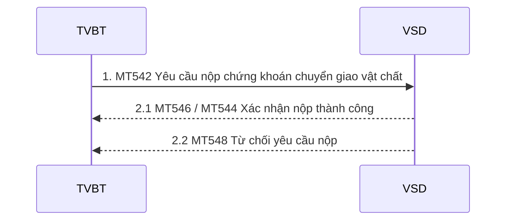
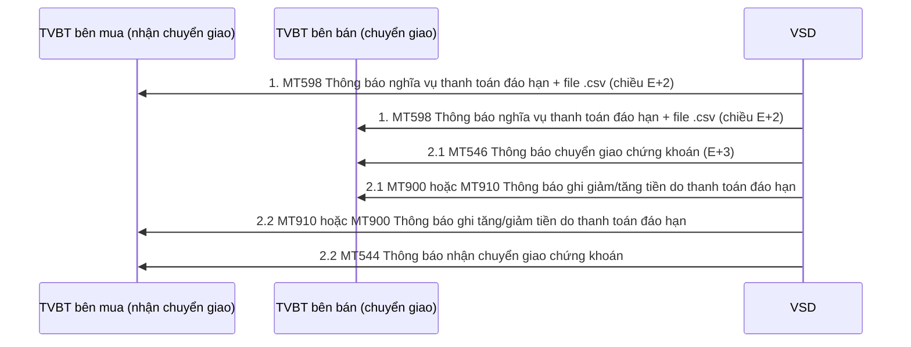

# Nhóm 5 — Thanh toán đáo hạn

> Nguồn: Phụ lục 06 (QĐ 115/QĐ-VSD ngày 31/05/2017) — Phần II, mục 5 (5.1–5.2). Nội dung chuyển thể nguyên văn từ file Word `Phu-luc-06.docx`; tra cứu thuật ngữ tại [00-tong-quan-va-thuat-ngu.md](../00-tong-quan-va-thuat-ngu.md).

## 5.1. Thanh toán đáo hạn bằng chuyển giao vật chất

### 5.1.1. TVBT nộp chứng khoán để chuyển giao vật chất

Trình tự thực hiện:

Để thực hiện nộp chứng khoán để chuyển giao vật chất trong trường hợp TVBT nắm giữ vị thế bán, TVBT thực hiện các bước sau:
- Bước 1: TVBT gửi điện MT542 yêu cầu nộp chứng khoán chuyển giao vật chất
- Bước 2: Hệ thống VSD kiểm tra và xử lý yêu cầu nộp chứng khoán chuyển giao vật chất:
- Trường hợp chuyển thành công sẽ gửi điện MT546/544 xác nhận yêu cầu nộp chứng khoán chuyển giao vật chất
- Trường hợp không thực hiện được sẽ gửi điện MT548 từ chối yêu cầu nộp chứng khoán chuyển giao vật chất

Trường hợp nhà đầu tư bên bán mất khả năng thanh toán chuyển giao trái phiếu, TVBT thực hiện vay chứng khoán qua hệ thống SBL. Chứng khoán vay được hạch toán vào tài khoản phong tỏa ký quỹ tự doanh đứng tên TVBT. VSD thực hiện giao dịch chuyển khoán số  lượng trái phiếu thiếu từ tài khoản phong tỏa ký quỹ tự doanh sang tài khoản tài khoản ký quỹ tại VSD của nhà đầu tư mất khả năng thanh toán. Sau khi hạch toán, hệ thống VSD gửi điện MT546 –Xác nhận yêu cầu nộp chứng khoán chuyển giao vật chất

#### MT542 –Yêu cầu nộp chứng khoán chuyển giao vật chất

| Status | Tag | Qualifier | Field Name | Description | Content | No. |
|---|---|---|---|---|---|---|
| **Bắt đầu Block: Thông tin chung** | | | | | | |
| `M` | `16R` | `GENL` |  |  |  | 1 |
| `M` | `20C` | `SEME` | Reference | Số hiệu tham chiếu của TVBT (giá trị này là duy nhất) | `:4!c//16x` | 2 |
| `M` | `23G` | `NEWM` | Function of the Message | NEWM: Yêu cầu chuyển khoản | `4!c` | 3 |
| `O` | `98A` | `PREP` | Preparation Date | Ngày tạo yêu cầu | `:4!c//8!n` | 4 |
| `O` | `16R` | `LINK` |  |  |  | 5 |
| `M` | `20C` | `PCTI` |  | Tham chiếu tới mã hợp đồng chuyển giao vật chất Bắt buộc phải có cho trường hợp giá trị của 22F là :STCO//EXER |  | 6 |
| `O` | `16S` | `LINK` |  |  |  | 7 |
| `M` | `16S` | `GENL` |  |  |  | 8 |
| **Kết thúc Block: Thông tin chung** | | | | | | |
| **Bắt đầu Block: Chuyển khoản chi tiết** | | | | | | |
| `M` | `16R` | `TRADDET` |  |  |  | 6 |
| `M` | `98A` | `SETT` | Date | Ngày giao dịch | `:4!c//8!n` | 7 |
| `M` | `35B` |  | Identification of the Financial Instrument | Chứng khoán | [ISIN1!e12!c] [/2!a/32x] | 8 |
| `O` | `16R` | `FIA` |  |  |  | 9 |
| `M` | `12A` | `4!c` | Type of Financial Instrument | Lấy giá trị :CLAS//NORM/1 | `:4!c//4!c/1!n` | 10 |
| `O` | `16S` | `FIA` |  |  |  | 11 |
| `O` | `70E` | `SPRO` | Narrative | Ghi chú | `:4!c//4*35x` | 12 |
| `M` | `16S` | `TRADDET` |  |  |  | 13 |
| **Kết thúc Block: Chuyển khoản chi tiết** | | | | | | |
| **Bắt đầu Block: Thông tin tài khoản chuyển** | | | | | | |
| `M` | `16R` | `FIAC` |  |  |  | 14 |
| `M` | `36B` | `SETT` | Quantity | Khối lượng  Giá trị của qualifier :SETT//UNIT, sử dụng cho cổ phiếu, chứng chỉ quỹ :SETT//FAMT, sử dụng cho trái phiếu | `:4!c//4!c/15d` | 15 |
| `O` | `70D` | `DENC` | Narrative | Ghi chú | `:4!c//6*35x` | 16 |
| `M` | `95P` | `ACOW` | Party | BICCODE của TVBT | `:4!c//4!a2!a2!c[3c]` | 17 |
| `M` | `97A` | `SAFE` | Account | Tài khoản của NĐT | `:4!c//35x` | 18 |
| `M` | `16S` | `FIAC` |  |  |  | 19 |
| **Kết thúc Block: Thông tin tài khoản chuyển** | | | | | | |
| **Bắt đầu Block: Thông tin thanh toán chi tiết** | | | | | | |
| `M` | `16R` | `SETDET` |  |  |  | 20 |
| `M` | `22F` | `SETR` | Indicator | Lấy giá trị :SETR//OWNE | `:4!c//4!c` | 21 |
| `M` | `22F` | `STCO` | Indicator | Lấy giá trị :STCO//EXER: Nộp | `:4!c//4!c` | 22 |
| `M` | `16R` | `SETPRTY` |  |  |  | 23 |
| `M` | `95P` | `PSET` | Place of settlement | Lấy giá trị VSDSVN06 | `:4!c//4!a2!a2!c[3c]` | 24 |
| `M` | `16S` | `SETPRTY` |  |  |  | 25 |
| `M` | `16R` | `SETPRTY` |  |  |  | 26 |
| `M` | `95P` | `DEAG` |  | BICCODE của TVBT | `:4!c//4!a2!a2!c[3c]` | 27 |
| `M` | `16S` | `SETPRTY` |  |  |  | 28 |
| `M` | `16R` | `SETPRTY` |  |  |  | 29 |
| `M` | `95P` | `REAG` |  | Lấy giá trị VSDSVN06 | `:4!c//4!a2!a2!c[3c]` | 30 |
| `M` | `97A` | `SAFE` | Account | Tài khoản của NĐT | `:4!c//35x` | 31 |
| `M` | `16S` | `SETPRTY` |  |  |  | 32 |
| `M` | `16S` | `SETDET` |  |  |  | 33 |
| **Kết thúc Block: Thông tin thanh toán chi tiết** | | | | | | |

#### MT546 –Xác nhận yêu cầu nộp chứng khoán chuyển giao vật chất cho bên chuyển

Hệ thống lưu ký xác nhận đã ghi giảm số dư

| Status | Tag | Qualifier | Field Name | Description | Content | No. |
|---|---|---|---|---|---|---|
| **Bắt đầu Block: Thông tin chung** | | | | | | |
| `M` | `16R` | `GENL` |  |  |  | 1 |
| `M` | `20C` | `SEME` | Reference | Số hiệu của tham chiếu của VSD | `:4!c//16x` | 2 |
| `M` | `23G` | `NEWM` | Function of the Message | Lấy giá trị NEWM | `4!c` | 3 |
| `O` | `98A` | `PREP` | Preparation Date | Ngày tạo | `:4!c//8!n` | 4 |
| `M` | `16R` | `LINK` |  |  |  | 5 |
| `O` | `13A` | `LINK` |  | Lấy giá trị :LINK/542 | `:4!c//3!c` | 6 |
| `M` | `20C` | `RELA` | Reference | Tham chiếu đến số hiệu yêu cầu | `:4!c//16x` | 7 |
| `M` | `16S` | `LINK` |  |  |  | 8 |
| `M` | `16S` | `GENL` |  |  |  | 9 |
| **Kết thúc Block: Thông tin chung** | | | | | | |
| **Bắt đầu Block: Thông tin chuyển khoản** | | | | | | |
| `M` | `16R` | `TRADDET` |  |  |  | 10 |
| `M` | `98A` | `ESET` | Date | Ngày hạch toán | `:4!c//8!n` | 11 |
| `M` | `35B` |  | Identification of the Financial Instrument | Chứng khoán | [ISIN1!e12!c] [/2!a/32x] | 12 |
| `O` | `70E` | `SPRO` |  | Ghi chú | `:4!c//10*35x` | 13 |
| `M` | `16S` | `TRADDET` |  |  |  | 14 |
| **Kết thúc Block: Thông tin chuyển khoản** | | | | | | |
| **Bắt đầu Block: Thông tin tài khoản chuyển** | | | | | | |
| `M` | `16R` | `FIAC` |  |  |  | 15 |
| `M` | `36B` | `ESTT` | Quantity | Khối lượng Giá trị của qualifier :ESTT//UNIT, sử dụng cho cổ phiếu, chứng chỉ quỹ :ESTT//FAMT, sử dụng cho trái phiếu | `:4!c//4!c/15d` | 16 |
| `M` | `95P` | `ACOW` | Party | BICCODE của TVBT | `:4!c//4!a2!a2!c[3c]` | 17 |
| `M` | `97A` | `SAFE` | Account | Số tài khoản ký quỹ phái sinh của NĐT | `:4!c//35x` | 18 |
| `M` | `16S` | `FIAC` |  |  |  | 19 |
| **Kết thúc Block: Thông tin tài khoản chuyển** | | | | | | |
| **Bắt đầu Block: Thông tin tài khoản nhận** | | | | | | |
| `M` | `16R` | `SETDET` |  |  |  | 20 |
| `M` | `22F` | `SETR` | Indicator | Lấy giá trị :SETR//OWNE | `:4!c//4!c` | 21 |
| `M` | `22F` | `STCO` | Indicator | Lấy giá trị :STCO//EXER: Nộp  :STCO//SPDL: Sử dụng khi VSD thực hiện chuyển khoản từ tài khoản phong tỏa của tự doanh TVBT cho NĐT chuyển giao vật chất. | `:4!c//4!c` | 22 |
| `M` | `16R` | `SETPRTY` |  |  |  | 23 |
| `M` | `95P` | `PSET` | Party | Lấy giá trị VSDSVN06 | `:4!c//4!a2!a2!c[3c]` | 24 |
| `O` | `20C` | `PROC` | Reference |  | `:4!c//16x` | 25 |
| `M` | `16S` | `SETPRTY` |  |  |  | 26 |
| `M` | `16R` | `SETPRTY` |  |  |  | 27 |
| `M` | `95P` | `REAG` | Party | BICCODE của TVBT | `:4!c//4!a2!a2!c[3c]` | 28 |
| `M` | `97A` | `SAFE` | Account | Số tài khoản ký quỹ phái sinh của NĐT | `:4!c//35x` | 29 |
| `M` | `16S` | `SETPRTY` |  |  |  | 30 |
| `M` | `16S` | `SETDET` |  |  |  | 31 |
| **Kết thúc Block: Thông tin tài khoản nhận** | | | | | | |

#### MT544 –Xác nhận yêu cầu nộp chứng khoán chuyển giao vật chất cho bên nhận

Hệ thống phái sinh xác nhận đã hạch toán ghi tăng số dư

| Status | Tag | Qualifier | Field Name | Description | Content | No. |
|---|---|---|---|---|---|---|
| **Bắt đầu Block: Thông tin chung** | | | | | | |
| `M` | `16R` | `GENL` |  |  |  | 1 |
| `M` | `20C` | `SEME` | Reference | Số hiệu tham chiếu của VSD | `:4!c//16x` | 2 |
| `M` | `23G` |  | Function of the Message | Lấy giá trị NEWM | `4!c` | 3 |
| `O` | `98A` | `PREP` | Preparation Date/ | Ngày tạo | `:4!c//8!n` | 4 |
| `M` | `16R` | `LINK` |  |  |  | 5 |
| `O` | `13A` | `LINK` |  | Lấy giá trị :LINK/542 | `:4!c//3!c` | 6 |
| `M` | `20C` | `RELA` | Reference | Tham chiếu đến số hiệu yêu cầu nộp | `:4!c//16x` | 7 |
| `M` | `16S` | `LINK` |  |  |  | 8 |
| `M` | `16S` | `GENL` |  |  |  | 9 |
| **Kết thúc Block: Thông tin chung** | | | | | | |
| **Bắt đầu Block: Thông tin giao dịch** | | | | | | |
| `M` | `16R` | `TRADDET` |  |  |  | 10 |
| `M` | `98A` | `ESET` |  | Ngày hiệu lực | `:4!c//8!n` | 11 |
| `M` | `35B` |  |  | Chứng khoán | [ISIN1!e12!c] [/2!a/32x] | 12 |
| `O` | `70E` | `SPRO` |  | Ghi chú | `:4!c//10*35x` | 13 |
| `M` | `16S` | `TRADDET` |  |  |  | 14 |
| **Kết thúc Block: Thông tin giao dịch** | | | | | | |
| **Bắt đầu Block: Thông tin chi tiết** | | | | | | |
| `M` | `16R` | `FIAC` |  |  |  | 15 |
| `M` | `36B` | `ESTT` | Quantity of financial instrument | Khối lượng Giá trị của qualifier :ESTT//UNIT, sử dụng cho cổ phiếu, chứng chỉ quỹ, chứng khoán phái sinh :ESTT//FAMT, sử dụng cho trái phiếu | `:4!c//4!c/15d` | 16 |
| `M` | `95P` | `ACOW` | Party | BICCODE của TVBT | `:4!c//4!a2!a2!c[3c]` | 17 |
| `M` | `97A` | `SAFE` |  | Tài khoản của nhà đầu tư | `:4!c//35x` | 18 |
| `M` | `16S` | `FIAC` |  |  |  | 19 |
| **Kết thúc Block: Thông tin chi tiết** | | | | | | |
| **Bắt đầu Block: Thanh toán chi tiết** | | | | | | |
| `M` | `16R` | `SETDET` |  |  |  | 20 |
| `M` | `22F` | `SETR` |  | Lấy giá trị :SETR//OWNE | `:4!c//4!c` | 21 |
| `M` | `22F` | `STCO` |  | Lấy giá trị :STCO//EXER: Nộp | `:4!c//4!c` | 22 |
| `M` | `16R` | `SETPRTY` |  |  |  | 23 |
| `M` | `95P` | `PSET` | Place of settlement | Lấy giá trị VSDSVN06 | `:4!c//4!a2!a2!c[3!c]` | 24 |
| `M` | `16S` | `SETPRTY` |  |  |  | 21 |
| `M` | `16R` | `SETPRTY` |  |  |  | 22 |
| `M` | `95P` | `DEAG` |  | BICCODE của TVBT | `:4!c//4!a2!a2!c[3c]` | 23 |
| `M` | `97A` | `SAFE` | Account | Tài khoản bên chuyển | `:4!c//35x` | 24 |
| `M` | `16S` | `SETPRTY` |  |  |  | 25 |
| `M` | `16S` | `SETDET` |  | End of  block SETDET |  | 26 |
| **Kết thúc Block: Thanh toán chi tiết** | | | | | | |

#### MT548 –Từ chối yêu cầu nộp chứng khoán chuyển giao vật chất

| Status | Tag | Qualifier | Field Name | Description | Content | No. |
|---|---|---|---|---|---|---|
| **Bắt đầu Block: Thông tin chung** | | | | | | |
| `M` | `16R` | `GENL` |  |  |  | 1 |
| `M` | `20C` | `SEME` | Reference | Số hiệu tham chiếu của VSD | `:4!c//16x` | 2 |
| `M` | `23G` | `INST` | Function of the Message |  | `4!c` | 3 |
| `O` | `98A` | `PREP` | Preparation Date | Ngày tạo message | `:4!c//8!n` | 4 |
| `M` | `16R` | `LINK` |  |  |  | 5 |
| `O` | `13A` | `LINK` | Number identification | Lấy giá trị :LINK//542 | `:4!c//3!c` | 6 |
| `M` | `20C` | `RELA` | Reference | Số hiệu tham chiếu của yêu cầu chuyển khoản | `:4!c//16x` | 7 |
| `M` | `16S` | `LINK` |  |  |  | 8 |
| `M` | `16R` | `STAT` |  |  |  | 9 |
| `M` | `25D` | `IPRC` | Status | Lấy giá trị :IPRC//REJT | `:4!c//4!c` | 10 |
| `M` | `16R` | `REAS` |  |  |  | 11 |
| `M` | `24B` | `REJT` | Reason | Lấy giá trị :REJT/NARR | `:4!c//4!c` | 12 |
| `O` | `70D` | `REAS` |  | Nội dung từ chối | `:4!c//6*35x` | 13 |
| `M` | `16S` | `REAS` |  |  |  | 14 |
| `M` | `16S` | `STAT` |  |  |  | 15 |
| `M` | `16S` | `GENL` |  |  |  | 16 |
| **Kết thúc Block: Thông tin chung** | | | | | | |

### 5.1.2 Thanh toán bằng chuyển giao vật chất

Đối với hình thức chuyển giao vật chất,  tại chiều ngày E+2 VSD sẽ gửi thông báo cho TVBT bên mua số tiền phải thanh toán dựa trên kết quả phân bổ ngẫu nhiên trái phiếu chuyển giao do TVBT bên bán đăng ký và/hoặc trái phiếu chuyển giao do VSD vay, mua (nếu TVBT bên bán mất khả năng thanh toán).

Trình tự thực hiện:

Bước 1: Vào chiều ngày E+2, VSD sẽ gửi điện MT598 đính kèm Thông báo nghĩa vụ thanh toán tiền cho TVBT bên mua, nghĩa vụ chuyển giao chứng khoán cho TVBT bên bán (Báo cáo kết quả phân bổ trái phiếu chuyển giao)

Bước 2:Tại ngày E+3 (ngày thanh toán cuối cùng), VSD thực hiện chuyển giao chứng khoán, chỉ thị cho NHTT thanh toán tiền và gửi thông báo kết quả thanh toán tiền, chứng khoán cho các TVBT liên quan.

#### MT546 –Thông báo chuyển giao chứng khoán

| Status | Tag | Qualifier | Field Name | Description | Content | No. |
|---|---|---|---|---|---|---|
| **Bắt đầu Block: Thông tin chung** | | | | | | |
| `M` | `16R` | `GENL` |  |  |  | 1 |
| `M` | `20C` | `SEME` | Reference | Số hiệu của tham chiếu của VSD | `:4!c//16x` | 2 |
| `M` | `23G` | `NEWM` | Function of the Message | Lấy giá trị NEWM | `4!c` | 3 |
| `O` | `98A` | `PREP` | Preparation Date | Ngày tạo | `:4!c//8!n` | 4 |
| `O` | `16R` | `LINK` |  |  |  | 5 |
| `M` | `20C` | `RELA` | Relation | Số tham chiếu hệ thống phái sinh | `:4!c//16x` | 6 |
| `O` | `16S` | `LINK` |  |  |  | 7 |
| `M` | `16S` | `GENL` |  |  |  | 8 |
| **Kết thúc Block: Thông tin chung** | | | | | | |
| **Bắt đầu Block: Thông tin chuyển khoản** | | | | | | |
| `M` | `16R` | `TRADDET` |  |  |  | 9 |
| `M` | `98A` | `ESET` | Date | Ngày hạch toán | `:4!c//8!n` | 10 |
| `M` | `35B` |  | Identification of the Financial Instrument | Chứng khoán chuyển giao vật chất | [ISIN1!e12!c] [/2!a/32x] | 11 |
| `O` | `70E` | `SPRO` |  | Ghi chú | `:4!c//10*35x` | 12 |
| `M` | `16S` | `TRADDET` |  |  |  | 13 |
| **Kết thúc Block: Thông tin chuyển khoản** | | | | | | |
| **Bắt đầu Block: Thông tin tài khoản chuyển** | | | | | | |
| `M` | `16R` | `FIAC` |  |  |  | 14 |
| `M` | `36B` | `ESTT` | Quantity | Khối lượng Giá trị của qualifier :ESTT//UNIT, sử dụng cho cổ phiếu, chứng chỉ quỹ, chứng khoán phái sinh :ESTT//FAMT, sử dụng cho trái phiếu | `:4!c//4!c/15d` | 15 |
| `M` | `95P` | `ACOW` | Party | BICCODE của TVBT bên chuyển | `:4!c//4!a2!a2!c[3c]` | 16 |
| `M` | `97A` | `SAFE` | Account | Tài khoản bên chuyển | `:4!c//35x` | 17 |
| `M` | `16S` | `FIAC` |  |  |  | 18 |
| **Kết thúc Block: Thông tin tài khoản chuyển** | | | | | | |
| **Bắt đầu Block: Thông tin tài khoản nhận** | | | | | | |
| `M` | `16R` | `SETDET` |  |  |  | 19 |
| `M` | `22F` | `SETR` | Indicator | Lấy giá trị là :SETR//OWNE | `:4!c//4!c` | 20 |
| `M` | `22F` | `STCO` |  | Lấy giá trị là :SETR//PHYS |  | 21 |
| `M` | `16R` | `SETPRTY` |  |  |  | 22 |
| `M` | `95P` | `PSET` | Party | Lấy giá trị là: VSDSVN06 | `:4!c//4!a2!a2!c[3c]` | 23 |
| `O` | `20C` | `PROC` | Reference |  | `:4!c//16x` | 24 |
| `M` | `16S` | `SETPRTY` |  |  |  | 25 |
| `M` | `16R` | `SETPRTY` |  |  |  | 26 |
| `M` | `95P` | `REAG` | Party | BICCODE của TVBT bên nhận | `:4!c//4!a2!a2!c[3c]` | 27 |
| `M` | `97A` | `SAFE` | Account | Số tài khoản giao dịch của NĐT bên nhận | `:4!c//35x` | 28 |
| `M` | `16S` | `SETPRTY` |  |  |  | 29 |
| `M` | `16S` | `SETDET` |  |  |  | 30 |
| **Kết thúc Block: Thông tin tài khoản nhận** | | | | | | |

#### MT544 - Thông báo nhận chuyển giao chứng khoán

| Status | Tag | Qualifier | Field Name | Description | Content | No. |
|---|---|---|---|---|---|---|
| **Bắt đầu Block: Thông tin chung** | | | | | | |
| `M` | `16R` | `GENL` |  |  |  | 1 |
| `M` | `20C` | `SEME` | Reference | Số hiệu tham chiếu của VSD | `:4!c//16x` | 2 |
| `M` | `23G` |  | Function of the Message | Lấy giá trị NEWM | `4!c` | 3 |
| `O` | `98A` | `PREP` | Preparation Date/ | Ngày tạo | `:4!c//8!n` | 4 |
| `O` | `16R` | `LINK` |  |  |  | 5 |
| `M` | `20C` | `RELA` | Relation | Số tham chiếu hệ thống phái sinh | `:4!c//16x` | 6 |
| `O` | `16S` | `LINK` |  |  |  | 7 |
| `M` | `16S` | `GENL` |  |  |  | 8 |
| **Kết thúc Block: Thông tin chung** | | | | | | |
| **Bắt đầu Block: Thông tin giao dịch** | | | | | | |
| `M` | `16R` | `TRADDET` |  |  |  | 9 |
| `M` | `98A` | `ESET` |  | Ngày hiệu lực | `:4!c//8!n` | 10 |
| `M` | `35B` |  |  | Chứng khoán | [ISIN1!e12!c] [/2!a/32x] | 11 |
| `O` | `70E` | `SPRO` |  | Ghi chú | `:4!c//10*35x` | 12 |
| `M` | `16S` | `TRADDET` |  |  |  | 13 |
| **Kết thúc Block: Thông tin giao dịch** | | | | | | |
| **Bắt đầu Block: Thông tin chi tiết** | | | | | | |
| `M` | `16R` | `FIAC` |  |  |  | 14 |
| `M` | `36B` | `ESTT` | Quantity of financial instrument | Khối lượng Giá trị của qualifier :ESTT//UNIT, sử dụng cho cổ phiếu, chứng chỉ quỹ, chứng khoán phái sinh :ESTT//FAMT, sử dụng cho trái phiếu | `:4!c//4!c/15d` | 15 |
| `M` | `95P` | `ACOW` | Party | BICCODE của TVBT | `:4!c//4!a2!a2!c[3c]` | 16 |
| `M` | `97A` | `SAFE` |  | Tài khoản của NĐT | `:4!c//35x` | 17 |
| `M` | `16S` | `FIAC` |  |  |  | 18 |
| **Kết thúc Block: Thông tin chi tiết** | | | | | | |
| **Bắt đầu Block: Thanh toán chi tiết** | | | | | | |
| `M` | `16R` | `SETDET` |  |  |  | 19 |
| `M` | `22F` | `SETR` | Indicator | Lấy giá trị là :SETR//OWNE | `:4!c//4!c` | 20 |
| `M` | `22F` | `STCO` |  | Lấy giá trị là :SETR//PHYS |  | 21 |
| **Bắt đầu Block: Đối tác thanh toán** | | | | | | |
| `M` | `16R` | `SETPRTY` |  |  |  | 22 |
| `M` | `95P` | `PSET` | Place of settlement | Lấy giá trị VSDSVN06 | `:4!c//4!a2!a2!c[3!c]` | 23 |
| `M` | `16S` | `SETPRTY` |  |  |  | 24 |
| `M` | `16R` | `SETPRTY` |  |  |  | 25 |
| `M` | `95P` | `DEAG` |  | BICCODE của TVBT bên chuyển | `:4!c//4!a2!a2!c[3c]` | 26 |
| `M` | `97A` | `SAFE` | Account | Tài khoản bên chuyển | `:4!c//35x` | 27 |
| `M` | `16S` | `SETPRTY` |  |  |  | 28 |
| **Kết thúc Block: Đối tác thanh toán** | | | | | | |
| `M` | `16S` | `SETDET` |  | End of  block SETDET |  | 29 |
| **Kết thúc Block: Thanh toán chi tiết** | | | | | | |

#### MT910 - Thông báo ghi tăng tiền trên tài khoản tiền thanh toán TVBT bên mua (do nộp tiền thanh toán hợp đồng đáo hạn)

Tương tự như đối với MT910 nộp tiền thanh toán lãi/lỗ vị thế

| Status | Tag | Qualifier | Field Name | Description | Content | No. |
|---|---|---|---|---|---|---|
| `M` | `20` |  | Transaction Reference Number | Số hiệu tham chiếu của VSD | `16x` | 1 |
| `M` | `21` |  | Related Reference | Số hiệu tham chiếu tại ngân hàng | `16x` | 2 |
| `M` | `25` |  | Account Identification | Số tài khoản của TVBT tại ngân hàng thanh toán VM Là tài khoản BICCODE.S | `35x` | 3 |
| `M` | `32A` |  | Value Date, Currency, Amount | Ngày giao dịch Loại tiền Số tiền | `6!n3!a15d` | 4 |
| `M` | `52A` |  |  | BICCODE của TVBT | `:4!c//4!a2!a2!c[3!c]` | 5 |
| `M` | `72` |  | Sender to Receiver information | Lấy giá trị: CRED | `35x` | 6 |

#### MT900 –Thông báo ghi giảm tiền do thanh toán đáo hạn (khi VSD ghi giảm tiền trên tài khoản tiền thanh toán của bên mua chuyển cho bên bán)

| Status | Tag | Qualifier | Field Name | Description | Content | No. |
|---|---|---|---|---|---|---|
| `M` | `20` |  | Transaction Reference Number | Số hiệu tham chiếu của VSD | `16x` | 1 |
| `M` | `21` |  | Related Reference | Số hiệu tham chiếu của ngân hàng | `16x` | 2 |
| `M` | `25` |  | Account Identification | Số tài khoản của TVBT tại ngân hàng ghi giảm Là tài khoản BICCODE.S | `35x` | 3 |
| `M` | `32A` |  | Value Date, Currency, Amount | Ngày giao dịch Loại tiền Số tiền | `6!n3!a15d` | 4 |
| `M` | `52A` |  |  | BICCODE của TVBT | `:4!c//4!a2!a2!c[3!c]` | 5 |
| `M` | `72` |  | Sender to Receiver information | Lấy giá trị là DELI | `35x` | 6 |

#### MT910 –Thông báo ghi tăng tiền do thanh toán đáo hạn trên tài khoản tiền thanh toán của bên bán

| Status | Tag | Qualifier | Field Name | Description | Content | No. |
|---|---|---|---|---|---|---|
| `M` | `20` |  | Transaction Reference Number | Số hiệu tham chiếu của VSD | `16x` | 1 |
| `M` | `21` |  | Related Reference | Số hiệu tham chiếu của ngân hàng | `16x` | 2 |
| `M` | `25` |  | Account Identification | Số tài khoản tại ngân hàng được ghi tăng số dư Là tài khoản BICCODE.S | `35x` | 3 |
| `M` | `32A` |  | Value Date, Currency, Amount | Ngày giao dịch Loại tiền Số tiền | `6!n3!a15d` | 4 |
| `M` | `52A` |  |  | BICCODE của TVBT | `:4!c//4!a2!a2!c[3!c]` | 5 |
| `M` | `72` |  | Sender to Receiver information | Lấy giá trị là DELI | `35x` | 6 |

#### MT900 - Thông báo ghi giảm trên tài khoản tiền thanh toán bên bán khi Ngân hàng thực hiện chuyển tiền từ tài khoản tiền thanh toán sang tài khoản tiền thành viên đăng ký

Tương tự như đối với thanh toán lãi/lỗ vị thế hàng ngày

| Status | Tag | Qualifier | Field Name | Description | Content | No. |
|---|---|---|---|---|---|---|
| `M` | `20` |  | Transaction Reference Number | Số hiệu tham chiếu của VIETINBANK | `16x` | 1 |
| `M` | `21` |  | Related Reference | Trùng với trường 20 | `16x` | 2 |
| `M` | `25` |  | Account Identification | Là tài khoản BICCODE.S | `35x` | 3 |
| `M` | `32A` |  | Value Date, Currency, Amount | Ngày giao dịch Loại tiền Số tiền | `6!n3!a15d` | 4 |
| `M` | `52A` |  |  | BICCODE của TVBT | `4!a2!a2!c[3!c]` | 5 |
| `M` | `72` |  | Sender to Receiver information | Lấy giá trị PAYMENT | `6*35x` | 6 |

## 5.2. Thanh toán đáo hạn bằng tiền

Hợp đồng tương lai chỉ số cổ phiếu thực hiện thanh toán đáo hạn bằng tiền. Hợp đồng tương lai trái phiếu chính phủ có thể thanh toán bằng tiền hoặc chuyển giao vật chất.

Trình tự thực hiện (thực hiện theo quy trình 4.2. Thực hiện thanh toán lãi lỗ vị thế)

