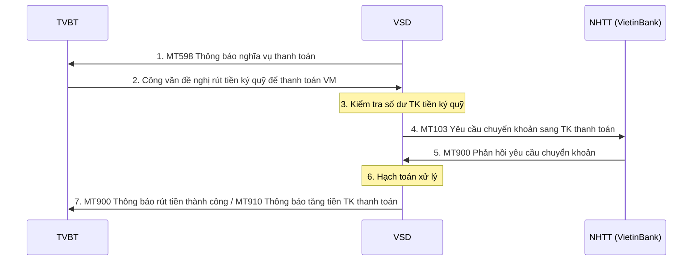
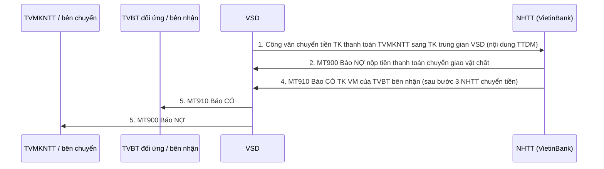

# Nhóm 6 — Xử lý mất khả năng thanh toán

> Nguồn: Phụ lục 06 (QĐ 115/QĐ-VSD ngày 31/05/2017) — Phần II, mục 6 (6.1–6.2). Nội dung chuyển thể nguyên văn từ file Word `Phu-luc-06.docx`; tra cứu thuật ngữ tại [00-tong-quan-va-thuat-ngu.md](../00-tong-quan-va-thuat-ngu.md).

## 6.1. VSD yêu cầu rút tiền ký quỹ để thực hiện thanh toán hàng ngày

Trình tự thực hiện:
- Bước 1: VSD gửi điện MT598 cho TVBT Thông báo nghĩa vụ thanh toán hàng ngày

Đối với TVBT không nộp đủ tiền vào TK tiền thanh toán (trong trường hợp mất khả năng thanh toán) và quyết định sử dụng tiền trên tài khoản tiền ký quỹ để hỗ trợ thanh toán thì áp dụng quy trình xử lý theo các bước dưới đây:
- Bước 2: TVBT gửi công văn cho VSD đề nghị rút tiền từ tài khoản tiền ký quỹ tự doanh/môi giới để thanh toán lãi/lỗ vị thế. (Trường hợp TVBT không gửi yêu cầu rút tiền ký quỹ để thanh toán lãi/lỗ vị thế, VSD sẽ chỉ định VIETINBANK chuyển tiền vào TK tiền thanh toán từ các nguồn (ký quỹ tự doanh/NĐT mất khả năng thanh toán , Quỹ bù trừ…))
- Bước 3: VSD kiểm tra số dư trên TK tiền ký quỹ:
- Nếu không đủ, VSD thông báo lại cho TVBT
- Nếu đủ, áp dụng bước 4 đến bước 8
- Bước 4: VSD gửi điện yêu cầu VIETINBANK thực hiện chuyển khoản từ TK tiền ký quỹ sang TK tiền thanh toán TVBT bằng điện MT103
- Bước 5: VIETINBANK xác nhận chuyển khoản thành công bằng điện MT900 (Báo Nợ trên tài khoản tiền ký quỹ TVBT)
- Bước 6: VSD thực hiện hạch toán trên tài khoản ký quỹ của NĐT/TVBT và gửi điện thông báo cho TVBT
- Bước 7: VSD sẽ gửi điện MT900 thông báo rút tiền thành công (sau khi có xác nhận của VIETINBANK với VSD)

Tiếp tục quy trình thanh toán như Bước 2 mục 4.1

#### MT103 –Yêu cầu rút tiền ký quỹ để thanh toán VM

| Status | Tag | Qualifier | Field Name | Description | Content | No. |
|---|---|---|---|---|---|---|
| `M` | `20` |  | Transaction Reference Number | Số hiệu tham chiếu yêu cầu của TVBT | `16x` | 1 |
| `M` | `23B` | `CRED` | Bank Operation Code |  | `4!c` | 2 |
| `M` | `32A` |  |  | Ngày hiệu lực/Loại tiền/Số tiền | `6!n3!a15d` | 3 |
| `M` | `50K` |  | Ordering Customer | Thông tin bên chuyển Là tài khoản BICCODE.C hoặc BICCODE.P | `34x` | 4 |
| `M` | `59` |  | Beneficiary Customer | 34x: Số tài khoản VM của TVBT Là tài khoản BICCODE.S | `34x` | 5 |
| `O` | `70` |  | Remittance information | IM2VM//Số tài khoản ký quỹ của NĐT | `35x` | 6 |
| `M` | `71A` |  |  | Lấy giá trị BEN | `3!a` | 7 |

#### MT900 –Thông báo rút tiền thành công

| Status | Tag | Qualifier | Field Name | Description | Content | No. |
|---|---|---|---|---|---|---|
| `M` | `20` |  | Transaction Reference Number | Số hiệu tham chiếu của VSD | `16x` | 1 |
| `M` | `21` |  | Related Reference | Số hiệu tham chiếu đến yêu cầu rút tiền của TVBT (trường 20 của MT103) | `16x` | 2 |
| `M` | `25` |  | Account Identification | Là giá trị trường 50K của điện MT103 | `35x` | 3 |
| `M` | `32A` |  | Value Date, Currency, Amount | Ngày giao dịch Loại tiền Số tiền | `6!n3!a15d` | 4 |
| `M` | `52A` |  |  | BICCODE của TVBT | `:4!c//4!a2!a2!c[3!c]` | 5 |
| `M` | `72` |  | Sender to Receiver information | Là giá trị trường 70 của điện MT103 | `35x` | 6 |

#### MT910 –Thông báo tăng tiền trên tài khoản thanh toán

| Status | Tag | Qualifier | Field Name | Description | Content | No. |
|---|---|---|---|---|---|---|
| `M` | `20` |  | Transaction Reference Number | Số hiệu tham chiếu của VSD | `16x` | 1 |
| `M` | `21` |  | Related Reference | Số hiệu tham chiếu đến yêu cầu rút tiền của TVBT (trường 20 của MT103) | `16x` | 2 |
| `M` | `25` |  | Account Identification | Số tài khoản tại ngân hàng được ghi tăng số dư Là tài khoản BICCODE.S | `35x` | 3 |
| `M` | `32A` |  | Value Date, Currency, Amount | Ngày giao dịch Loại tiền Số tiền | `6!n3!a15d` | 4 |
| `M` | `52A` |  |  | BICCODE của TVBT | `:4!c//4!a2!a2!c[3!c]` | 5 |
| `M` | `72` |  | Sender to Receiver information | Là giá trị trường 70 của điện MT103 | `35x` | 6 |

## 6.2. Xử lý mất khả năng thanh toán đáo hạn chuyển giao vật chất (chuyển sang thực hiện thanh toán thay thế bằng tiền)

VSD sẽ tách nghĩa vụ thanh toán của thành viên bên mất khả năng chuyển giao TPCP (TVMKNTT) và  thành viên đối ứng ra để thực hiện thanh toán ngoài hệ thống. Giá trị thanh toán mà TVBTMKNTT phải thanh toán thực hiện theo Quy chế của VSD.

Bước 1: VSD gửi cho công văn đề nghị NHTT chuyển tiền từ tài khoản thanh toán của TVMKNTT sang tài khoản thanh toán trung gian của VSD (ghi nội dung: TTDM)

Bước 2: NHTT gửi điện MT900 báo nợ tài khoản thanh toán của TVMKNTT sang VSD

#### MT900 –Báo NỢ nộp tiền thanh toán chuyển giao vật chất

| Status | Tag | Qualifier | Field Name | Description | Content/Options | No. |
|---|---|---|---|---|---|---|
| `M` | `20` |  | Transaction Reference Number | Số hiệu tham chiếu của VIETINBANK | `16x` | 1 |
| `M` | `21` |  | Related Reference | - (số tham chiếu từ hệ thống ngoài vào VTB) -&gt; VTB check lại - Trường hợp không có giá trị lấy F20. | `16x` | 2 |
| `M` | `25` |  | Account Identification | Là tài khoản BICCODE.C hoặc BICCODE.P | `35x` | 3 |
| `M` | `32A` |  | Value Date, Currency, Amount | Ngày giao dịch Loại tiền Số tiền | `6!n3!a15d` | 4 |
| `M` | `52A` |  |  | BICCODE của TVBT | `4!a2!a2!c[3!c]` | 5 |
| `M` | `72` |  | Sender to Receiver information | TTDM | `6*35x` | 6 |

Điện MT900 sẽ được VIETINBANK trả về cho VSD

Bước 3: NHTT cắt tiền từ tài khoản thanh toán trung gian của VSD sang tài khoản VM của thành viên bên nhận

Bước 4: NHTT gửi điện MT910 báo có tài khoản VM của thành viên bên nhận cho VSD

#### MT910 – Báo CÓ nộp tiền thanh toán chuyển giao vật chất

| Status | Tag | Qualifier | Field Name | Description | Content | No. |
|---|---|---|---|---|---|---|
| `M` | `20` |  | Transaction Reference Number | Số hiệu báo CÓ của VIETINBANK | `16x` | 1 |
| `M` | `21` |  | Related Reference | - (số tham chiếu từ hệ thống ngoài vào VTB) -&gt; VTB check lại - Trường hợp không có giá trị lấy F20. | `16x` | 2 |
| `M` | `25` |  | Account Identification | Là tài khoản BICCODE.S | `35x` | 3 |
| `M` | `32A` |  | Value Date, Currency, Amount | Ngày giao dịch Loại tiền Số tiền | `6!n3!a15d` | 4 |
| `M` | `52A` |  |  | BICCODE của TVBT | `4!a2!a2!c[3!c]` | 5 |
| `M` | `72` |  | Sender to Receiver information | TTDM | `73x` | 6 |

Điện MT910 sẽ được VIETINBANK trả về cho VSD

Bước 5: VSD gửi điện MT910 báo có cho thành viên bên nhận

VSD gửi điện MT900 báo nợ cho thành viên bên chuyển

