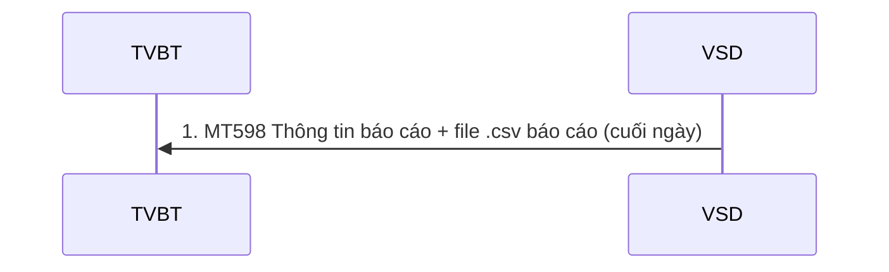
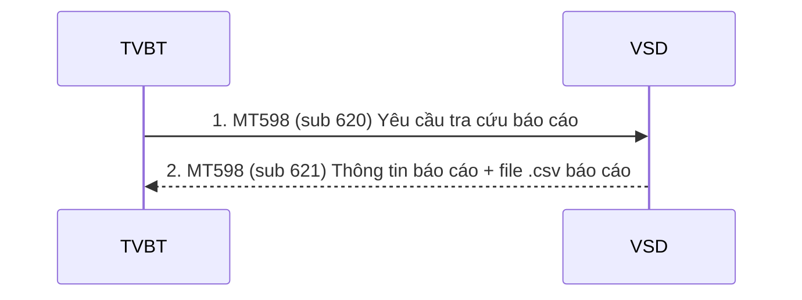

# Nhóm 7 — Báo cáo

> Nguồn: Phụ lục 06 (QĐ 115/QĐ-VSD ngày 31/05/2017) — Phần II, mục 7 (7.1–7.3). Nội dung chuyển thể nguyên văn từ file Word `Phu-luc-06.docx`; tra cứu thuật ngữ tại [00-tong-quan-va-thuat-ngu.md](../00-tong-quan-va-thuat-ngu.md).

## 7.1 Báo cáo gửi tự động

Cuối ngày, hệ thống CCP sẽ gửi cho TVBT các báo cáo sau:

| STT | Tên báo cáo | Mã báo cáo | Diễn giải | Thời gian |
|---|---|---|---|---|
| 1 | Daily trade Report | `TRADE` | Thông tin tổng hợp kết quả giao dịch HĐTL của các tài khoản thuộc TVBT | Cuối ngày |
| 2 | Position Report | `POSITION` | Thông tin tất cả các vị thế của một tài khoản, được định giá lãi/lỗ theo giá DSP gần nhất | Cuối ngày |
| 3 | Collateral Report | `COLLATERAL` | Thông tin về tài sản đảm của các tài khoản thuộc TVBT | Cuối ngày |
| 4 | Margin Report | `MARGIN` | Thông tin về giá trị ký quỹ yêu cầu, tỷ lệ sử dụng tài sản đảm bảo cho mỗi tài khoản thuộc TVBT | Cuối ngày |
| 5 | Daily settlement Report | `SETTLEMENT` | Thông tin về giá trị thanh toán cuối ngày của TVBT | Cuối ngày |
| 6 | Physical Delivery Report | `PHYSICAL` | Thông báo  HĐTL đáo hạn thực hiện chuyển giao vật chất | Cuối các ngày E+1 |
| 7 | BOND | `BOND` | Kết quả phân bổ trái phiếu chuyển giao | Cuối ngày E+2 |
| 8 | Confirmation Message Report | `INST_TRADE` | Danh sách chứng khoán phái sinh được phép giao dịch | Cuối ngày |
| 9 | Confirmation Message Report | `INST_COLLAT` | Chứng khoán cơ sở được phép nhận làm tài sản đảm bảo | Cuối ngày |

### Báo cáo số 8 và số 9: sử dụng MT598 – Thông tin chi tiết về danh mục chứng khoán

| Status | Tag | Qualifier | Field Name | Description | Content | No. |
|---|---|---|---|---|---|---|
| `M` | `20` |  | Transaction Reference Number | Số hiệu tham chiếu của VSD | `16x` | 1 |
| `M` | `12` |  | Sub-Message Type | Lấy giá trị 605 | `3!n` | 2 |
| `M` | `77E` |  | Proprietary Message | Mã báo cáo • INST\_TRADE: Chứng khoán phái sinh được phép giao dịch • INST\_COLLAT: Chứng khoán cơ sở được phép nhận làm tài sản đảm bảo | `73x` | 3 |
| **Bắt đầu Block: Thông tin chung** | | | | | | |
| `M` | `16R` | `GENL` |  |  |  | 4 |
| `M` | `23G` | `NEWM` | Function of the message | Lấy giá trị NEWM | `4!c` | 5 |
| `M` | `98A` | `PREP` | Preparation Date | Ngày tạo báo cáo | `:4!c//8!n` | 6 |
| `M` | `16R` | `LINK` |  |  |  | 7 |
| `M` | `20C` | `PREV` | Report Reference | Tên file .csv báo cáo | `:4!c//16x` | 8 |
| `M` | `16S` | `LINK` |  |  |  | 9 |
| `M` | `20C` | `STAT` | Report Reference | Tên của báo cáo, date-name-recipient [Date]\_INST\_TRADE\_CCPIG\_[Recipient] Hoặc [Date]\_INST\_COLLAT\_CCPIG\_[Recipient] Ví dụ: • 20160323\_INST\_TRADE\_CCPIG\_001 | `:4!c//35x` | 10 |
| `M` | `16S` | `GENL` |  |  |  | 11 |
| **Kết thúc Block: Thông tin chung** | | | | | | |

### Báo cáo từ số 1 và số 7: sử dụng MT598 – Thông tin chi tiết về báo cáo

| Status | Tag | Qualifier | Field Name | Description | Content | No. |
|---|---|---|---|---|---|---|
| `M` | `20` |  | Transaction Reference Number | Số hiệu tham chiếu của VSD | `16x` | 1 |
| `M` | `12` |  | Sub-Message Type | Lấy giá trị 621 | `3!n` | 2 |
| `M` | `77E` |  | Proprietary Message | Mã báo cáo | `73x` | 3 |
| **Bắt đầu Block: Thông tin chung** | | | | | | |
| `M` | `16R` | `GENL` |  |  |  | 4 |
| `M` | `23G` | `NEWM` | Function of the message | Lấy giá trị NEWM | `4!c` | 5 |
| `M` | `98A` | `PREP` | Preparation Date | Ngày tạo báo cáo | `:4!c//8!n` | 6 |
| `M` | `16R` | `LINK` |  |  |  | 7 |
| `M` | `20C` | `PREV` | Report Reference | Tên file .csv báo cáo | `:4!c//16x` | 8 |
| `M` | `16S` | `LINK` |  |  |  | 9 |
| `M` | `20C` | `STAT` | Report Reference | The name of the report, date-name-recipient [Date]\_[Report name]\_[Recipient] e.g: • 20160323\_Reportcode\_001 | `:4!c//35x` | 10 |
| `M` | `16S` | `GENL` |  |  |  | 11 |
| **Kết thúc Block: Thông tin chung** | | | | | | |

## 7.2 Báo cáo theo yêu cầu theo TVBT

| STT | Tên báo cáo | Mã báo cáo | Diễn giải | Thời gian |
|---|---|---|---|---|
| 1 | Daily trade Report | `TRADE` | Thông tin tổng hợp kết quả giao dịch HĐTL của các tài khoản thuộc TVBT | Theo yêu cầu trong ngày |
| 2 | Position Report | `POSITION` | Thông tin tất cả các vị thế của một tài khoản, được định giá lãi/lỗ theo giá DSP gần nhất | Theo yêu cầu trong ngày |
| 3 | Collateral Report | `COLLATERAL` | Thông tin về tài sản đảm của các tài khoản thuộc TVBT | Theo yêu cầu trong ngày |
| 4 | Margin Report | `MARGIN` | Thông tin về giá trị ký quỹ yêu cầu, tỷ lệ sử dụng tài sản đảm bảo cho mỗi tài khoản thuộc TVBT | Theo yêu cầu trong ngày |
| 5 | Daily settlement Report | `SETTLEMENT` | Thông tin về giá trị thanh toán cuối ngày của TVBT | Theo yêu cầu trong ngày |
| 6 | Physical Delivery Report | `PHYSICAL` | Thông báo  HĐTL đáo hạn thực hiện chuyển giao vật chất | Theo yêu cầu trong ngày |

TVBT có nhu cầu xem:
- Báo cáo nghiệp vụ theo quy chế của VSD
- Báo cáo được đề cập trong phần 7.1 mà TVBT muốn tra cứu theo thời gian thực loại trừ:   + Daily settlement report - Thông tin về giá trị thanh toán cuối ngày của TVBT
- Physical Delivery Report: Thông báo HĐTL đáo hạn thực hiện chuyển giao vật chất.

Trình tự thực hiện:
- Bước 1: TVBT gửi bằng điện MT 598 yêu cầu tra cứu báo cáo
- Bước 2: VSD nhận, xử lý và gửi thông tin báo cáo qua điện MT598 kèm file .csv

### Bước 1: MT598 – Yêu cầu tra cứu báo cáo

| Status | Tag | Qualifier | Field Name | Description | Content | No. |
|---|---|---|---|---|---|---|
| `M` | `20` |  | Transaction Reference Number | Số hiệu tham chiếu của của TVBT | `16x` | 1 |
| `M` | `12` |  | Sub-Message Type | The value is 620 | `3!n` | 2 |
| `M` | `77E` |  | Proprietary Message | Tham số báo cáo (Là các code báo cáo đề cập trong mục 7.1 nêu trên, loại trừ  các báo cáo BOND INST\_TRADE, INST\_COLLAT) | `20*78x` | 3 |
| **Start of Block: General information** | | | | | | |
| `M` | `16R` | `GENL` |  | Start of Block GENL |  | 4 |
| `M` | `23G` | `NEWM` | Function of the message | The value is NEWM | `4!c` | 5 |
| `M` | `98A` | `PREP` | Preparation Date | Requested Date | `:4!c//8!n` | 6 |
| `M` | `13B` | `STAT` |  | Mã báo cáo | `:4!c//16x` | 7 |
| `M` | `16S` | `GENL` |  | End of Block GENL |  | 8 |
| **End of Block: General information** | | | | | | |

### Bước 2: MT598 – Thông tin chi tiết về báo cáo

| Status | Tag | Qualifier | Field Name | Description | Content | No. |
|---|---|---|---|---|---|---|
| `M` | `20` |  | Transaction Reference Number | Số hiệu tham chiếu của VSD | `16x` | 1 |
| `M` | `12` |  | Sub-Message Type | Lấy giá trị 621 | `3!n` | 2 |
| `M` | `77E` |  | Proprietary Message | Mã báo cáo | `73x` | 3 |
| **Bắt đầu Block: Thông tin chung** | | | | | | |
| `M` | `16R` | `GENL` |  |  |  | 4 |
| `M` | `23G` | `NEWM` | Function of the message | Lấy giá trị NEWM | `4!c` | 5 |
| `M` | `98A` | `PREP` | Preparation Date | Ngày tạo báo cáo | `:4!c//8!n` | 6 |
| `M` | `16R` | `LINK` |  |  |  | 7 |
| `M` | `20C` | `PREV` | Report Reference | Tên file .csv báo cáo | `:4!c//16x` | 8 |
| `M` | `16S` | `LINK` |  |  |  | 9 |
| `M` | `20C` | `STAT` | Report Reference | The name of the report, date-name-recipient [Date]\_[Report name]\_[Recipient] e.g: • 20160323\_Reportcode\_001 | `:4!c//35x` | 10 |
| `M` | `16S` | `GENL` |  |  |  | 11 |
| **Kết thúc Block: Thông tin chung** | | | | | | |

## 7.3 Cấu trúc báo cáo

### 7.3.1 Cấu trúc file .par gửi kèm với kết quả báo cáo như sau:

| Tên | Loại dữ liệu | Ghi chú - Độ dài hoặc giá trị cho phép |
|---|---|---|
| SwiftTime | DateTime | &lt;!SWIFTTIME&gt; Thời điểm xử lý tại VSD Gateway ISO 8601 datetime format &lt;YYYY-MM-DD&gt;T&lt;HH:MM&gt; Ví dụ: 2007-04-05T14:30 |
| NonRep | Boolean | Mặc định là FALSE string matches "FALSE" | "TRUE" |
| DeliveryTime | DateTime | &lt;!DELIVERTIME&gt; Thời điểm truyền dữ liệu ISO 8601 datetime format |
| MsgId | String | &lt;!STPREFSEQID&gt; Số sequence do VSDGateway tạo ra string length &lt;= 40 |
| Creationtime | DateTime | &lt;$FILECREATETIME&gt; Thời điểm tạo tệp tin dữ liệu (thuộc tính của file dữ liệu) ISO 8601 datetime format |
| PDIndication | Boolean | Mặc định là FALSE string matches "FALSE" | "TRUE" |
| Requestor | UserDN | Thông tin bên gửi (BICCODE của TVBT) o=&lt;$VSDBICCODE&gt;, o=swift string length &lt;= 100 |
| Responder | UserDN | Thông tin bên nhận (BICCODE của VSD) o=&lt;$MEMBERBICCODE&gt;, o=swift string length &lt;= 100 |
| Service | String | Mặc định là: swift.corp.fast string length &lt;= 30 |
| RequestType | String | Mặc định là camt.xxx.fisp.rep string length &lt;= 30 |
| Priority | String | Mặc định là Normal string matches "Normal" | "Urgent" |
| RequestRef | String | &lt;$REFREQID&gt; Là giá trị trường 20 của điện MT598 kèm theo string length &lt;= 30 |
| TransferRef | String | &lt;$EVENTCODE&gt; Lấy giá trị là POSITION string length &lt;= 30 |
| TransferDescription | String | &lt;$EVENTNAME&gt; string matches any\* length &lt;= 256 octet |
| TransferInfo | String | &lt;$MEMBERBICCODE&gt;.&lt;$REPORTCODE&gt;.&lt;$SYSDATE&gt;.&lt;$ RequestRef &gt; string matches US ASCII\* length &lt;= 256 |
| PossibleDuplicate | Boolean | Mặc định là TRUE string matches "FALSE" | "TRUE" |
| OrigTransferRef | String | Số reference của hệ thống VSD gửi ra string length &lt;= 30 |
| AckIndicator | Boolean | Mặc định là FALSE string matches "FALSE" | "TRUE" |
| LogicalName |  | Tên tệp tin dữ liệu Sw filename |
| FileDescription | String | Mô tả thêm (có thể không dùng) string matches any\* length &lt;= 256 octet |
| FileInfo | String | Mặc định: SwCompression=None string matches US ASCII\* length &lt;= 256 |
| Size |  | &lt;$FILESIZE&gt; Kích thước tệp tin dữ liệu integer &lt;= 0 |
| SNLId | String | string length &lt;= 30 |
| SNLEP | String | string length &lt;= 15 |
| AckResponder | UserDN | &lt;Không dùng&gt; string length &lt;= 100 |
| AckRequestType | String | &lt;Không dùng&gt; string length &lt;= 30 |
| DigestAlgorithm | String | &lt;Không dùng&gt; string matches "SHA-1" | "SHA-256" |
| DigestValue | String | &lt;Không dùng&gt; string length &lt;= 50 |

### 7.3.2 Cấu trúc file csv gửi kèm các báo cáo như sau:

#### 7.3.2.1. Báo cáo TRADE

| No. | Field Name | Description | Content |
|---|---|---|---|
| 1 | id |  |  |
| 2 | state | Trạng thái lệnh |  |
| 3 | reference | Số hiệu lệnh |  |
| 4 | settlement | Ngày khớp lệnh |  |
| 5 | time | Thời gian khớp lệnh |  |
| 6 | account | Số tài khoản |  |
| 7 | buy/sell | Mua/bán |  |
| 8 | code | Mã hợp đồng |  |
| 9 | instrument name | Tên hợp đồng |  |
| 10 | quantity | Số lượng |  |
| 11 | currency | Tiền tệ |  |
| 12 | price | Giá |  |

#### 7.3.2.2 Báo cáo POSITION

| No. | Field Name | Description | Content |
|---|---|---|---|
| 1 | id |  |  |
| 2 | account | Tài khoản Nhà đầu tư |  |
| 3 | investor | Tên Nhà đầu tư |  |
| 4 | code | Mã hợp đồng |  |
| 5 | name | Tên hợp đồng |  |
| 6 | deliver | Số lượng phải giao |  |
| 7 | receive | Số lượng nhận |  |
| 8 | net | Net |  |
| 9 | im | IM |  |
| 10 | vm | VM |  |
| 11 | wasp | Giá trung bình mua |  |
| 12 | wapb | Giá trung bình bán |  |
| 13 | due | Ngày đáo hạn |  |
| 14 | Value (DSP) | DSP |  |

#### 7.3.2.3. Báo cáo MARGIN

| No. | Field Name | Description | Content |
|---|---|---|---|
| 1 | account | Tài khoản |  |
| 2 | clearing member | Tên thành viên |  |
| 3 | investor | Tên nhà đầu tư |  |
| 4 | total margin | Tổng ký quỹ |  |
| 5 | initial margin | Ký quỹ ban đầu |  |
| 6 | spread margin | Ký quỹ song hành |  |
| 7 | variation margin | Ký quỹ biến đổi |  |
| 8 | delivery margin | Ký quỹ chuyển giao |  |
| 9 | total collateral | Tổng tài sản đảm bảo |  |
| 10 | eligible collateral | Tài sản hợp lệ |  |
| 11 | percent | Phần trăm |  |

#### 7.3.2.4. Báo cáo COLLATERAL

| No. | Field Name | Description | Content |
|---|---|---|---|
| 1 | id |  |  |
| 2 | clearing member | Tên thành viên |  |
| 3 | investor | Tên nhà đầu tư |  |
| 4 | account | Tài khoản |  |
| 5 | opening balance | Số dư đầu ngày |  |
| 6 | closing balance | Số dư cuối ngày |  |
| 7 | instrument | Mã kỹ quỹ |  |
| 8 | haircut | Harcut |  |
| 9 | cash | Tiền |  |
| 10 | securities quantity | Số lượng kỹ quỹ |  |
| 11 | securities value | Giá trị ký quỹ |  |
| 12 | difference | Phát sinh trong ngày |  |

#### 7.3.2.5. Báo cáo SETTLEMENT

| No. | Field Name | Description | Content |
|---|---|---|---|
| 1 | id |  |  |
| 2 | clearing member | Tên thành viên |  |
| 3 | investor | Tên Nhà đầu tư |  |
| 4 | account | Tài khoản nhà đầu tư |  |
| 5 | pay | Số tiền phải trả |  |
| 6 | receive | Số tiền được nhận |  |

#### 7.3.2.6. Báo cáo PHYSICAL

| No. | Field Name | Description | Content |
|---|---|---|---|
| 1 | cm | Tên thành viên |  |
| 2 | trading account | Số tài khoản giao dịch |  |
| 3 | margin account | Số tài khoản ký quỹ |  |
| 4 | instrument | Mã  hợp đồng |  |
| 5 | short (contracts) | Số hợp đồng bán |  |
| 6 | long (contracts) | Số hợp đồng mua |  |
| 7 | final trading date | Ngày giao dịch cuối cùng |  |
| 8 | settlement date | Ngày thanh toán |  |

#### 7.3.2.7. Báo cáo BOND

| No. | Field Name | Description | Content |
|---|---|---|---|
| 1 | cm | Thành viên |  |
| 2 | settlement date | Ngày thanh toán |  |
| 3 | margin account | Tài khoản nhà đầu tư |  |
| 4 | deliverable bond code | Mã trái phiếu chuyển giao |  |
| 5 | receive quantity | Số lượng nhận |  |
| 6 | pay quantity | Số lượng phải giao |  |
| 7 | receive value | Giá trị nhận |  |
| 8 | pay value | Giá trị phải giao |  |

Cấu trúc file csv danh sách chứng khoán như sau:

#### 7.3.2.8. INST_TRADE – Chứng khoán được phép giao dịch

| No. | Field Name | Description | Content |
|---|---|---|---|
| 1 | Date |  | `YYYYMMDD` |
| 2 | ISIN |  |  |
| 3 | Code | HNX trading code |  |
| 4 | Name | Full instrument name |  |
| 5 | Live Date | Date instrument can be used on the AvenirClear system | `YYYYMMDD` |
| 6 | Settlement Date | Settlement or Maturity Date | `YYYYMMDD` |
| 7 | Margin Rate | IM Margin rate percentage | `11.12 = 11.12%` |
| 8 | Daily Settlement Price |  |  |
| 9 | Place of Listing |  |  |

#### 7.3.2.9. INST_COLLAT – Chứng khoán cơ sở được phép làm tài sản đảm bảo

| No. | Field Name | Description | Content |
|---|---|---|---|
| 1 | Date |  | `YYYYMMDD` |
| 2 | ISIN |  |  |
| 3 | Code | HNX or other trading code |  |
| 4 | Name | Full instrument name |  |
| 5 | Currency | ISO currency code |  |
| 6 | Last Price |  |  |
| 7 | Haircut % | The haircut percentage | `20 = 20%` |
| 8 | Expiry Date | Date after which Instrument can not be used as collateral | `YYYYMMDD` |

